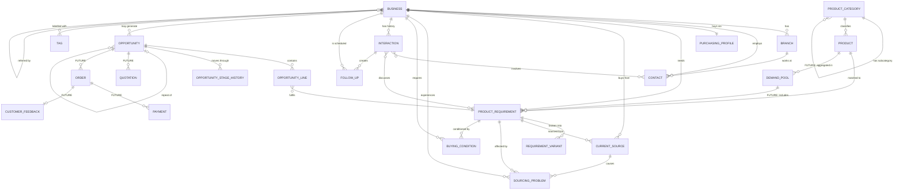

# Customer Purchasing Intelligence System — Customer Module Design

**Status:** Design proposal, v0.1 (no code written yet)
**Date:** 23 November 2026
**Scope confirmed by owner:**
- Web app, used on a laptop and on a tablet during customer visits.
- Single user (the owner) for now. The design leaves room for staff later.
- Version 1 covers customer research and demand only. Quotations, orders, payments and logistics are designed as future modules, with clear connection points.

**Existing code:** none. The project folder was empty when this design was written, so there are no existing features or data to preserve.

**Notation used in this document**
- **[ASSUMPTION]** marks something I inferred that you need to confirm.
- **[DECISION NEEDED]** marks a choice only you can make (all of them are collected in Section 12).
- **Priority:** **E** = Essential (collect whenever possible), **R** = Recommended, **O** = Optional, **F** = Future version.
- **Req-save:** the very few fields required before a record can be saved. Everything else may stay blank.
- **Stage:** 1 = First contact, 2 = Purchasing discovery, 3 = Qualified opportunity, 4 = Transaction and relationship.
- **Prov.** ✓ means the field carries *provenance*: where the information came from, a confidence basis, and when it was last verified (see Section 2.3).

---

## Table of contents

1. Business and requirements analysis
2. Core design principles (provenance, demand vocabulary, statuses)
3. Database architecture and ER diagram
4. Complete data dictionary
5. Progressive registration workflow
6. Customer profile interface
7. Product-demand architecture and demand aggregation
8. Customer classification and scoring
9. Interaction and follow-up system
10. Reports and dashboards
11. Privacy, confidentiality and security
12. Integration with future modules
13. Implementation roadmap
14. Risks and weaknesses
15. Questions and decisions needed from you

---

## 1. Business and requirements analysis

### 1.1 What this system is for

The business runs this chain:

> Demand discovery → Demand qualification → Supplier sourcing → Wholesale negotiation → Procurement → Logistics/import route → Addis Ababa distribution → Repeat purchasing

The customer module covers the **first two steps** fully and feeds the rest. Its job is to answer one question for every business you meet:

> **Who buys what, how do they buy it, what problems do they face, when will they buy again, and can we build a commercially valuable sourcing relationship with them?**

Contact management is a side effect. The real asset this database builds is **verified purchasing intelligence**: a growing, evidence-based picture of recurring demand in Addis Ababa that you can source against, aggregate across customers, and serve repeatedly.

### 1.2 The most important information to preserve

Ranked by business value:

1. **Recurring product requirements per business.** Exact product, specification, quantity per order, order frequency, and next expected purchase. This is what you source against.
2. **Real, evidenced purchasing problems.** What their current sourcing fails to solve, how often, and what it costs them. This is the reason a customer would ever buy from you.
3. **Buying conditions.** What a new source must satisfy (price ceiling, authenticity proof, MOQ, payment terms, confidentiality). Without these, a quotation is a guess.
4. **Decision-makers.** Who decides, who pays, and who only influences.
5. **Timing.** When the next purchase will happen, so you arrive *before* it, not after.
6. **Interaction history with evidence separation.** What the customer actually said, kept apart from what you observed and what you assume.
7. **Outcomes.** Why opportunities were won or lost, and which acquisition routes produced real customers, so the process improves over time.

### 1.3 How the 19 business problems map to the design

| # | Problem | Design answer |
|---|---------|---------------|
| 1 | Approaching businesses randomly | Pre-contact **Relevance Check** (§8.2), business type and sector taxonomy, prospect list filters |
| 2 | Identifying decision-makers | `contact` with separate **purchasing authority** and **payment authority** fields, with provenance |
| 3 | Products bought repeatedly | `product_requirement` records (many per business), with a **purchase pattern** field |
| 4 | Monthly demand vs quantity per order | Separate fields: `qty_per_order`, `order_interval`, `monthly_demand` (stated or calculated, and labelled as which) |
| 5 | Accurate specifications | Shared **product catalog**, structured specification, variants, reference photos, barcode |
| 6 | Current suppliers without forcing confidential details | `current_source` records the *type* of source. Supplier name is optional, hidden by default, and "declined to say" is a valid answer |
| 7 | Real problems, not assumed ones | `sourcing_problem` requires a basis (customer stated / observed / our inference) and a defined severity. "Well served — no problem" is a valid, recorded outcome |
| 8 | Stock-outs and consequences | Stock-out frequency, duration and consequence fields on each requirement |
| 9 | Small-order / MOQ difficulties | Smallest practical order, largest affordable order, MOQ as a problem category and as a buying condition |
| 10 | What makes them consider a new source | `buying_condition` records + `willingness_to_test` field |
| 11 | Interest vs real commitment | Separate **demand status** (discovery) and **commitment level** (commercial). Reserved ≠ confirmed. Only payment or a written order counts as confirmed |
| 12 | Next purchasing opportunity | `next_purchase_date` with a precision field, plus auto-generated reminders |
| 13 | Structured interaction history | `interaction` with separate fields for statements, observations and interpretation |
| 14 | Forgetting interested customers | Follow-up rules: any active requirement or opportunity without an open follow-up is flagged as **orphaned** |
| 15 | Repeat-purchase opportunities | Purchase cycle × last purchase date → predicted next purchase → reminder |
| 16 | Demand aggregation | Requirements link to one shared catalog product, so compatible demand can be summed (§7.4) |
| 17 | Confidentiality and exclusivity | Business-level confidentiality setting, exclusivity as a structured buying condition, supplier names hidden by default |
| 18 | Evidence-based evaluation | Provenance on every changing value. Scoring discounts estimates and ignores assumptions (§8) |
| 19 | Learning from completed transactions | Won/lost reasons, acquisition-source attribution, stage timing, post-delivery feedback (§10) |

---

## 2. Core design principles

### 2.1 The customer is the business, not the person

A "customer" in this system is a **business**. People are **contacts** of that business. A shop owner who changes, or a manager who leaves, should not erase the business's purchasing history.

### 2.2 Progressive, never mandatory

Only three things are required to save a new business: a name or identifying description, a business type, and either one phone number or a location. Everything else can stay blank and be filled across later visits. The system shows **profile completeness** to guide you; it never blocks you.

### 2.3 Provenance: every changing fact says where it came from

Each important value that can change (prices, quantities, stock status, authority, problems) carries three extra pieces of information:

| Provenance field | Type | Meaning |
|---|---|---|
| `basis` | dropdown | How we know this (see values below) |
| `verified_at` | date | When it was last confirmed |
| `source_interaction_id` | link | The conversation it came from, if any |

**Basis values (one standard list, used everywhere):**

| Value | Meaning | Counts as evidence in scoring? |
|---|---|---|
| `confirmed` | The customer told us directly | Yes (full weight) |
| `observed` | We saw it ourselves (shelf, stock, price tag) | Yes (full weight) |
| `documented` | Supported by a document (invoice, receipt, photo, price list) | Yes (full weight) |
| `calculated` | Computed by the system from other values | Inherits the weakest basis of its inputs |
| `estimate` | Our reasoned estimate | Half weight |
| `assumption` | An unverified guess | No |
| `unknown` | We asked; the customer does not know | No |
| `not_disclosed` | We asked; the customer declined to say | No (and we do not ask again soon) |
| *(blank)* | Not asked yet | No |

Note: "unknown", "not disclosed" and "not asked yet" are three different situations. Keeping them separate stops you re-asking a question a customer already declined, and tells you which gaps are worth filling.

**To keep this practical:** provenance is set per *group* of related fields (for example, all price fields share one basis and one verified date), not per individual field. The default basis when you type during a logged interaction is `confirmed`, and you change it only when it is not.

**Staleness rules** (configurable; the starting values are **[ASSUMPTION]**):

| Group | Considered stale after |
|---|---|
| Current price | 60 days |
| Stock status | 30 days |
| Quantity, frequency, monthly demand | 120 days |
| Next purchase date | When the date passes without an update |
| Decision authority | 365 days |

Stale values remain visible but are shown faded with a "needs re-check" marker, and they feed the "data to verify" list on the dashboard.

**History:** whenever a provenance-tracked value changes, the old value, basis and date go to a history table automatically. You do not do anything extra; you can later see, for example, that a customer's price went from 850 to 1,100 ETB over six months.

### 2.4 Two separate ladders: discovery and commitment

Mixing "interest" with "orders" is the most common CRM failure. This design uses two different status ladders.

**A. Requirement demand status** (per product requirement: *how well do we understand this need?*)

| Status | Entry rule (evidence required) |
|---|---|
| `mentioned` | The product came up in conversation |
| `interested` | The customer said they would consider another source for it |
| `specified` | Exact product/spec, quantity per order and frequency are known (basis ≥ estimate) |
| `qualified` | Specified **and** buying conditions known **and** next purchase timing known **and** a decision-maker has been engaged **and** willingness to test is at least "open with conditions" |
| `well_served` | The customer is satisfied with the current source and has no addressable problem. Still recorded, because it is real market intelligence |
| `not_pursuing` | We decided not to pursue it (with a reason) |

The system checks the entry rules. You cannot set `qualified` while required evidence is missing; it tells you what is missing.

**B. Opportunity stage** (commercial: *how close is a real transaction?*)

| Stage | Meaning | Commitment level |
|---|---|---|
| `identified` | Created from one or more qualified requirements | None |
| `sourcing` | We are researching suppliers and landed cost | None |
| `quoted` | Quotation sent | None |
| `negotiating` | Terms under discussion | None |
| `reserved` | The customer asked us to hold, or gave a verbal yes. **No payment** | Verbal |
| `confirmed` | Deposit or full payment received, or a written/signed order | Financial or written |
| `in_fulfilment` | Procurement / transit (mirrors future order and logistics modules) | — |
| `delivered` | Goods received by the customer | — |
| `closed_won` | Delivered and paid in full | — |
| `closed_lost` | Lost, with a mandatory reason | — |
| `cancelled` | Withdrawn by either side, with a reason | — |

**Rule:** only `confirmed` and later stages count as orders in any report. `reserved` is reported separately as "verbal commitments".

### 2.5 Standard vocabulary

To avoid confusing terms, the system uses these words consistently:

| Term | Definition |
|---|---|
| **Business** | The customer organization |
| **Contact** | A person at a business |
| **Requirement** | One recurring or planned product need of one business |
| **Order quantity** | Units bought in a single purchase |
| **Order interval** | Typical time between purchases of that product |
| **Monthly demand** | Units consumed or sold per month (stated, or calculated as order quantity ÷ interval in months) |
| **Source** | Where the business currently buys a product (type, not necessarily name) |
| **Problem** | A specific, recorded difficulty with current sourcing |
| **Buying condition** | Something a new source must satisfy |
| **Opportunity** | A potential transaction built from one or more requirements |
| **Interaction** | Any recorded contact (visit, call, message) |
| **Follow-up** | A scheduled future action |

Words to **avoid** in the interface: "lead" (ambiguous), "hot/cold customer" (unsupported judgement), "good/bad customer".

### 2.6 Naming and ID conventions

- Every record has an internal ID (UUID) and a short human-readable code:
  `BUS-0001` business, `CON-0001` contact, `REQ-0001` requirement, `PRB-0001` problem, `INT-0001` interaction, `FUP-0001` follow-up, `OPP-0001` opportunity, `PRD-0001` catalog product.
- Database names use `snake_case`; dropdown values are stored as stable codes (`not_disclosed`) and displayed as labels ("Not disclosed"). Labels can later be translated into Amharic without touching data.
- Money is always stored as an amount **plus** currency **plus** date. Never a bare number.
- Phone numbers are stored in international format (`+2519…`, `+2517…`) and displayed locally.

---

## 3. Database architecture

### 3.1 Recommended technology approach

Because nothing exists yet, I am not assuming a framework. My **recommendation** (to be confirmed in §15):

- **A relational database** (PostgreSQL recommended). This data is highly connected (businesses → requirements → problems → opportunities) and the most valuable reports are cross-cutting queries such as "sum demand for product X across all qualified customers buying in the next 60 days". Relational databases do that reliably; document databases make it harder and tend to duplicate data.
- **A web app that works well on tablets**, with a hosted database, authentication and private file storage, so data is backed up and reachable from any device.
- **Offline capture** for customer visits is a real need if mobile data is unreliable in the markets you visit. It adds complexity, so it is a **[DECISION NEEDED]** (§15). The fallback in v1 is a very short Quick Capture form that works on a weak connection.

### 3.2 Entities

**Core (version 1)**

| Entity | Purpose | Relationship |
|---|---|---|
| `business` | The customer organization | Root record |
| `branch` | Physical locations, including the main shop | Business 1 → many |
| `contact` | People at the business | Business 1 → many; optional link to a branch |
| `purchasing_profile` | How the business buys in general | Business 1 → 1 |
| `product_category` | Two-level product taxonomy | Self-referencing (category → subcategory) |
| `product` | Shared catalog item (brand + model level) | Many requirements → 1 product |
| `product_requirement` | One product need of one business | Business 1 → many; product many → 1 (optional until matched) |
| `requirement_variant` | Size/colour/capacity breakdown of a requirement | Requirement 1 → many |
| `current_source` | Where they currently buy (type, optional name) | Business 1 → many; optional link to a requirement |
| `sourcing_problem` | Specific, evidenced difficulty | Business 1 → many; optional links to a requirement and a source |
| `buying_condition` | What a new source must satisfy | Business 1 → many; optional link to a requirement |
| `interaction` | A recorded call, visit, message or meeting | Business 1 → many |
| `interaction_contact` | Who took part | Interaction many ↔ many contacts |
| `interaction_requirement` | Which products were discussed | Interaction many ↔ many requirements |
| `follow_up` | Scheduled next action | Business 1 → many; optional links to contact, requirement, opportunity, interaction |
| `opportunity` | Potential transaction | Business 1 → many |
| `opportunity_line` | Requirement(s) included, with quantity | Opportunity 1 → many; each line → 1 requirement |
| `opportunity_stage_history` | Dated stage changes | Opportunity 1 → many |
| `tag`, `business_tag` | Flexible labels | Business many ↔ many tags |
| `attachment` | Files and photos | Linked to any record (business, requirement, problem, interaction, opportunity) |
| `value_history` | Automatic history of provenance-tracked values | Any record → many |
| `lookup_value` | Editable dropdown lists | Used by all |

**Future (designed now, built later)**

| Entity | Purpose | Connects to |
|---|---|---|
| `demand_pool` + `demand_pool_member` | Aggregated demand across customers for one product and purchase window | Requirements, product, future procurement |
| `quotation` + `quotation_line` | Quotations | Opportunity, requirement, product |
| `order` + `order_line` | Confirmed orders | Opportunity, requirement, product |
| `payment` | Deposits and balances | Order |
| `customer_feedback` | Post-delivery feedback | Order, business |
| `supplier` | Supplier database (separate module) | `current_source` (optional), sourcing requests |

### 3.3 Entity-relationship diagram



### 3.4 Key architectural decisions and why

1. **Product requirement is a separate record, not columns on the customer.** One business can need 30 products, each with its own quantity, price, problems and timing. Each must be tracked, qualified and followed up independently.
2. **A shared product catalog, linked from requirements.** Without it, "Samsung 25W charger", "samsung 25 watt adapter" and "S-25W" are three different things and demand can never be aggregated (problem 16). A requirement can be saved with free text first and matched to a catalog product later, so this does not slow down field work.
3. **Sources, problems and conditions can be business-level or product-level.** "They always pay cash" is business-level; "Chargers are often fake" is product-level. One table each, with an optional requirement link, avoids two parallel structures.
4. **Purchasing profile is a separate one-to-one table.** It keeps the business record short and loads only when needed. It also makes it obvious which businesses have had a discovery conversation.
5. **Problems are their own records, not checkboxes.** A checkbox "price problem" says nothing. A problem record says what happens, how often, how badly, what they do about it now, and who said so.
6. **Interactions separate three kinds of content:** what the customer said, what we observed, and what we think. This directly enforces the rule "do not treat an assumption as fact".
7. **Opportunities are separate from requirements.** A requirement is a long-lived need (they buy phone cases every month, forever). An opportunity is one specific attempt to fulfil it. One requirement can produce many opportunities over time; that is what repeat business looks like in data.
8. **Calculated values are calculated, not typed.** Scores, completeness, monthly demand (when not stated), days since last contact and order counts are computed, so they can never disagree with the underlying data.
9. **Future modules link by ID; they do not copy data.** An order references the requirement and product; it does not duplicate the specification.

---

## 4. Complete data dictionary

Column key: **Pri** = priority (E/R/O/F); **Stg** = collection stage (1–4, or "auto"); **Prov** = provenance tracked (✓). Standard fields on every table (`id`, `code`, `created_at`, `updated_at`, `archived_at`) are not repeated below.

### 4.1 `business`

| Field | Type | Pri | Stg | Allowed values / validation | Purpose and decision supported | Prov |
|---|---|---|---|---|---|---|
| `trading_name` | text | E, Req-save | 1 | 2–120 chars. If no signboard name, use a description, e.g. "Phone shop opposite Tana Market, 2nd floor" | Identify and find the business | |
| `alternate_names` | text list | R | 1–2 | Free text, multiple | Amharic/English spellings and nicknames; essential for **duplicate detection** and search | |
| `legal_name` | text | O | 3–4 | — | Needed only for formal quotes/invoices later | |
| `business_type` | dropdown | E, Req-save | 1 | `retailer`, `specialist_retailer`, `wholesaler`, `distributor`, `importer`, `service_business`, `online_seller`, `workshop_manufacturer`, `institutional_buyer`, `other` | Its role in the supply chain. Drives which questions matter (a wholesaler's volumes and MOQ needs differ from a salon's) | |
| `sectors` | multi-select | E | 1 | `cosmetics_beauty`, `hair_salon_supplies`, `electronics`, `mobile_accessories`, `footwear`, `clothing_apparel`, `household`, `stationery_office`, `auto_parts`, `hardware_tools`, `medical_pharma` (regulated flag), `food_beverage` (regulated flag), `other` — **[DECISION NEEDED]** final list | What they deal in. Used for targeting and to group demand | |
| `product_range_summary` | text | R | 1–2 | ≤ 500 chars | What they sell overall, in a sentence. Context for discovery | |
| `customer_segment` | multi-select | R | 2 | `consumers`, `businesses`, `both` | Who *they* sell to; influences volumes and quality needs | |
| `price_positioning` | dropdown | O | 2 | `budget`, `mid_market`, `premium`, `mixed`, `unknown` | Matches them to product grades and suppliers | ✓ |
| `sales_channels` | multi-select | R | 2 | `physical_shop`, `wholesale_counter`, `telegram`, `tiktok`, `instagram`, `facebook`, `website_marketplace`, `field_sales`, `b2b_contracts` | Online sellers and multi-channel shops have different restock patterns | |
| `staff_size_band` | dropdown | R | 1–2 | `1-2`, `3-5`, `6-20`, `21-50`, `51+`, `unknown` | Observable size proxy, so you never need to ask for revenue | ✓ |
| `years_operating_band` | dropdown | O | 2 | `<1`, `1-3`, `3-10`, `10+`, `unknown` | Stability indicator for credit decisions later | |
| `acquisition_source` | dropdown | E | 1 | `cold_visit`, `referral`, `social_media`, `inbound_call_message`, `personal_network`, `event_market`, `other` | **Learning (problem 19):** which channels produce real customers | |
| `referred_by_business_id` | link → business | R | 1 | Required if `acquisition_source = referral` and the referrer is in the system | Referral tracking and thanking referrers | |
| `relevance_check` | 4 checkboxes | R | 0–1 | See §8.2 | Decide **before** approaching whether the business is worth a visit (problem 1) | |
| `relationship_stage` | dropdown (mostly auto) | auto | auto | `prospect`, `contacted`, `in_discovery`, `qualified`, `active_opportunity`, `first_order_customer`, `repeat_customer`, `dormant`, `not_a_fit`, `do_not_contact` | Where the relationship stands. Calculated from activity; can be overridden with a reason | |
| `sourcing_status` | dropdown | E | 2 | `well_served`, `partially_served`, `underserved`, `unknown` | Honest overall picture: does this business actually have unsolved sourcing problems? | ✓ |
| `not_a_fit_reason` | dropdown + text | R | any | `no_recurring_demand`, `products_outside_scope`, `too_small`, `regulated_products`, `already_well_served`, `trust_or_ethics_concern`, `other` | Explains why it is parked; teaches targeting | |
| `confidentiality_level` | dropdown | R | 2–3 | `standard`, `do_not_disclose_relationship` (never tell others they buy from us), `strict` (also exclude from anonymized demand reports) | Respect customer confidentiality (problem 17) | ✓ |
| `tin` | text | F | 4 | 10 digits | **Business** tax number, only when issuing formal invoices. Not a personal ID | |
| `notes` | long text | O | any | — | Anything that fits nowhere else | |
| *calculated* `profile_completeness_pct` | number | auto | auto | 0–100 | Shows what to collect next | |
| *calculated* `priority_score` | number | auto | auto | See §8 | Orders the work list | |
| *calculated* `last_interaction_at`, `next_follow_up_at`, `open_requirements_count`, `qualified_requirements_count` | various | auto | auto | — | Summary cards and filters | |

**Removed or changed from the original brief, and why**
- "Size": replaced by **observable** staff-size band. Asking a business for revenue is intrusive and usually gets an unreliable answer.
- "Industry" and "business category": split into `business_type` (role in the supply chain) and `sectors` (what they deal in). These were being used as one concept, which makes filtering confusing.
- "Location": moved to `branch`, because a business can have several.

### 4.2 `branch`

| Field | Type | Pri | Stg | Allowed values / validation | Purpose |
|---|---|---|---|---|---|
| `business_id` | link | E | 1 | Required | Parent |
| `branch_label` | text | R | 1 | Default "Main shop" | Distinguish locations |
| `is_main` | checkbox | E | 1 | Exactly one main branch per business | Default location for visits |
| `city` | dropdown | E | 1 | Default `Addis Ababa`; editable list | Most customers are in Addis; supports regional buyers later |
| `sub_city` | dropdown | E | 1 | Addis Ababa's 11 sub-cities: Addis Ketema, Akaki Kality, Arada, Bole, Gulele, Kirkos, Kolfe Keranio, Lemi Kura, Lideta, Nifas Silk-Lafto, Yeka | Route planning and area analysis |
| `woreda` | number | O | 2 | 1–15 **[ASSUMPTION]** range | Finer location if useful |
| `area` | text with suggestions | E | 1 | Suggestions such as Merkato, Piassa, Bole, Mexico, Kazanchis, Megenagna, Sar Bet, CMC; free text allowed | How people in Addis actually describe locations |
| `directions` | text | R | 1 | e.g. "Building name, floor, shop number, landmark" | Formal street addresses are often not used; this is how you find the shop again |
| `gps_location` | lat/long | R | 1 | Captured from the device with one tap | Map view and visit routing |
| `branch_phone` | phone | O | 1 | International format | Shop line, if different from contacts |
| `opening_hours` | text | O | 2 | — | Plan visits and deliveries |
| `storage_note` | text | O | 2 | — | Storage limits explain small order quantities |

### 4.3 `contact`

| Field | Type | Pri | Stg | Allowed values / validation | Purpose | Prov |
|---|---|---|---|---|---|---|
| `business_id` | link | E | 1 | Required | Parent | |
| `branch_id` | link | O | 1–2 | — | Where they work | |
| `name` | text | E | 1 | Name as known is fine ("Ato Dawit", "Selam – manager") | Address people correctly | |
| `job_title` | text | R | 1 | — | Context | |
| `decision_roles` | multi-select | E | 1–2 | `owner`, `purchasing_decision_maker`, `payment_approver`, `influencer`, `gatekeeper`, `staff_user`, `unknown` | **Problem 2:** know who actually decides | ✓ |
| `purchasing_authority` | dropdown | E | 2 | `final`, `shared`, `recommends_only`, `none`, `unknown` | Whether this person can commit to buying | ✓ |
| `payment_authority` | dropdown | R | 2–3 | `final`, `shared`, `none`, `unknown` | Whether this person can approve payment; prevents "yes" from someone who cannot pay | ✓ |
| `is_primary_contact` | checkbox | E | 1 | One per business recommended | Default person to contact | |
| `phone_primary` | phone | E | 1 | `+251` + 9 digits starting with 9 or 7; duplicate check across all contacts | Main contact channel; duplicate detection | |
| `phone_secondary` | phone | O | 1–2 | Same validation | Backup | |
| `whatsapp` | checkbox or number | R | 1 | Default: same as primary phone | Channel availability | |
| `telegram` | text | R | 1 | Handle or phone | Very common business channel in Ethiopia | |
| `email` | email | O | 1–2 | Valid email format | Formal quotes later | |
| `preferred_channel` | dropdown | R | 1–2 | `visit`, `call`, `whatsapp`, `telegram`, `sms`, `email` | Contact people the way they respond | |
| `best_time_to_contact` | text | O | 2 | e.g. "Mornings before 10, not Sundays" | Higher response rate | |
| `language_preference` | dropdown | O | 1 | `amharic`, `english`, `afaan_oromo`, `other` | Communication | |
| `contact_permission` | dropdown | E | 1 | `allowed_all`, `allowed_specific_channels`, `asked_not_to_contact`, `not_asked` | **Required before follow-ups.** `asked_not_to_contact` blocks new follow-ups | |
| `permitted_channels` | multi-select | R | 1 | Same values as preferred channel | Respect stated limits | |
| `permission_recorded_at` | date | E | 1 | Auto-filled when permission changes | Evidence of consent | |
| `opt_out_reason` | text | O | any | — | Learn why people opt out | |
| `notes` | text | O | any | — | — | |

**Do not collect:** national ID or passport numbers, date of birth, home address, family details, personal bank details, or photos of people. None of these supports a business decision in this module.

### 4.4 `purchasing_profile` (one per business, Stage 2)

| Field | Type | Pri | Allowed values / validation | Purpose | Prov |
|---|---|---|---|---|---|
| `restock_process` | long text | R | "How does a typical restock happen?" in their words | Understand the real process before proposing anything | ✓ |
| `source_types_used` | multi-select | E | `local_wholesaler`, `local_importer`, `brand_distributor_ethiopia`, `own_direct_import`, `import_via_agent_or_traveller`, `online_local`, `online_international`, `manufacturer_direct`, `other` | General sourcing mix (details per product go in `current_source`) | ✓ |
| `imports_directly` | dropdown | R | `yes_regularly`, `yes_occasionally`, `no`, `unknown` | Importers are partners or competitors, not only customers; changes the approach | ✓ |
| `restock_trigger` | multi-select | R | `when_stock_runs_out`, `fixed_schedule`, `when_cash_available`, `supplier_offer`, `seasonal_peaks`, `customer_orders` | Predicts timing and how a reminder should be framed | ✓ |
| `typical_purchase_value_band` | dropdown | O (sensitive) | ETB bands **[DECISION NEEDED]**, plus `not_disclosed` | Rough scale without asking exact figures | ✓ |
| `payment_methods_used` | multi-select | E | `cash`, `bank_transfer`, `mobile_money` (telebirr, M-PESA), `cheque`, `supplier_credit`, `other` | What we must accept | ✓ |
| `payment_timing` | dropdown | R | `full_prepayment`, `deposit_then_balance`, `on_delivery`, `credit_terms`, `mixed`, `unknown` | Cash-flow fit; credit expectations are a key risk | ✓ |
| `credit_days_expected` | number | O | 0–180 | Only if they expect credit | ✓ |
| `goods_receipt_method` | multi-select | R | `collects_from_supplier`, `supplier_delivers`, `third_party_transport`, `courier` | Distribution design for Addis | ✓ |
| `expected_lead_time_days` | number | R | 0–180 | What "fast enough" means to them | ✓ |
| `needs_formal_receipt` | dropdown | R | `vat_invoice_required`, `receipt_required`, `not_required`, `unknown` | Legitimate businesses often need proper documentation; affects which suppliers and routes are usable | ✓ |
| `purchasing_constraints` | multi-select | E | `cash_flow`, `storage_space`, `forex_access`, `import_permits`, `customs_uncertainty`, `moq_too_high`, `transport`, `none_known` | Explains *why* they buy the way they do | ✓ |
| `constraints_note` | text | O | — | Detail | |

### 4.5 `product_category` and `product` (shared catalog)

**`product_category`**: `name`, `parent_id` (null for top level), `is_regulated` (for example cosmetics and medical products that may require Ethiopian Food and Drug Authority registration **[ASSUMPTION — confirm which categories apply]**), `sort_order`.

**`product`**

| Field | Type | Pri | Validation | Purpose |
|---|---|---|---|---|
| `category_id` | link | E | Must be a subcategory | Grouping and aggregation |
| `name` | text | E | Standard naming pattern: *Brand – Product type – Model – Key spec* | One canonical name |
| `brand` | text with suggestions | R | From an editable brand list, or "Generic/Unbranded" | Matching and authenticity |
| `model_sku` | text | R | — | Exact identification |
| `barcode_gtin` | text | O | 8, 12, 13 or 14 digits with a valid check digit | Exact matching; can be scanned with the tablet camera later |
| `key_specifications` | key–value list | R | e.g. `wattage: 25W`, `connector: USB-C`, `volume: 250ml` | Precise spec without free-text ambiguity |
| `standard_unit` | dropdown | E | `piece`, `pair`, `pack`, `box`, `carton`, `dozen`, `kg`, `litre`, `metre`, `set` | All quantities must use comparable units |
| `units_per_pack` | number | O | > 0 | Convert cartons and packs to pieces for aggregation |
| `reference_images` | attachments | R | — | Visual confirmation |
| `is_regulated` | checkbox | auto | Inherited from category | Warning before sourcing |

This table becomes the **Product Database** module later. Requirements point to it now, so nothing has to be migrated.

### 4.6 `product_requirement` (the core record)

Grouped so the form can show one group at a time. Provenance applies per group.

**Group A — What the product is** (Stage 1 minimum, refined in Stage 3)

| Field | Type | Pri | Stg | Validation / values | Purpose |
|---|---|---|---|---|---|
| `business_id` | link | E, Req-save | 1 | — | Owner |
| `customer_description` | text | E, Req-save | 1 | The product in the customer's own words | Captured quickly during conversation; never lost when matched |
| `category_id` | link | E | 1 | Category or subcategory | Allows filtering before an exact match exists |
| `product_id` | link → product | R | 2–3 | Matched to the catalog; suggested automatically from the description | **Aggregation, sourcing and quotes depend on this** |
| `brand_requirement` | dropdown | R | 2 | `exact_brand_only`, `equivalent_brands_ok`, `any_meeting_spec` | How flexible the requirement is |
| `accepted_alternatives` | links → product + text | O | 3 | — | Gives sourcing more room |
| `specification_notes` | text | R | 3 | Anything not captured by the product's key specs | Avoid wrong-spec deliveries |
| `condition_required` | dropdown | R | 2 | `new`, `refurbished`, `used`, `any` | Spec clarity |
| `authenticity_required` | dropdown | E | 2 | `genuine_brand_required`, `generic_acceptable`, `either_with_clear_labelling` | Determines suppliers and proof needed. **Counterfeit or "replica" products are deliberately not an option** (legal and reputational risk) |
| `variants` | → `requirement_variant` rows | O | 3 | size / colour / capacity / other + share of quantity | Multi-variant products such as shoes and clothing |
| `reference_links` | URL list | O | 2–3 | Valid URLs | Exact item reference |
| `reference_photos` | attachments | R | 1–3 | Image files | Photo of the product on their shelf is often the fastest spec |

**Group B — Purchase pattern** (Stage 2; Prov ✓)

| Field | Type | Pri | Validation / values | Purpose |
|---|---|---|---|---|
| `purchase_pattern` | dropdown | E | `recurring`, `seasonal`, `project_or_one_off`, `unknown` | **Problem 3:** recurring needs are the business model; one-offs are lower value |
| `qty_per_order` | number + unit | E | > 0; unit defaults to the product's standard unit | **Problem 4:** size of each purchase |
| `order_interval` | number + period | E | e.g. every 2 weeks / 1 month / 3 months | **Problem 4:** how often |
| `monthly_demand` | number + unit | E | If left blank, calculated as qty ÷ interval in months, with basis `calculated` | **Problem 4:** consumption rate; the basis for aggregation |
| `last_purchase_date` | date | R | Not in the future | Predict the next purchase |
| `last_purchase_qty` | number | R | > 0 | Validates usual quantity |
| `smallest_practical_order` | number | R | > 0 | **Problem 9:** what they can afford or store in one go |
| `largest_possible_order` | number | O | ≥ smallest | Upper limit, constrained by cash or storage |
| `seasonality_months` | multi-select | O | Months; quick picks for key Ethiopian periods: New Year (Meskerem), Meskel, Genna, Timket, Fasika, Eid holidays, school opening | Plan stock ahead of peaks |
| `seasonality_note` | text | O | — | — |

*Changed from the brief:* "Minimum and maximum quantity" was ambiguous (whose minimum?), so it became **smallest practical order** (the customer's own limit) and **largest possible order**. A supplier's MOQ is recorded separately, as a problem or a buying condition. "Usual purchase quantity" and "estimated monthly demand" are both kept, deliberately separate, with monthly demand calculated when not stated.

**Group C — Current price** (Stage 2–3; Prov ✓; often not disclosed, and that is acceptable)

| Field | Type | Pri | Validation | Purpose |
|---|---|---|---|---|
| `current_unit_price` | money | R | > 0 | Benchmark that any offer must beat |
| `price_currency` | dropdown | R | `ETB`, `USD`, `AED`, `other` | Prices are compared on a dated basis |
| `price_per_unit` | dropdown | R | Same values as the unit list | "850 per piece" vs "850 per pack" is the most common pricing error |
| `price_includes_vat` | dropdown | R | `yes`, `no`, `unknown` | Like-for-like comparison |
| `price_includes_delivery` | dropdown | R | `yes`, `no`, `unknown` | Like-for-like comparison |
| `target_price` | money | O | — | Their stated goal, only if they volunteer it |
| `max_acceptable_price` | money | O | ≥ target if both set | Their stated ceiling, only if volunteered |

Basis for Group C should normally be `confirmed`, `observed` (shelf/price tag; note this is their *selling* price, not their buying price) or `documented`. A price recorded as an `estimate` is clearly marked as such.

**Group D — Stock and availability** (Stage 2; Prov ✓)

| Field | Type | Pri | Values | Purpose |
|---|---|---|---|---|
| `current_stock_status` | dropdown | R | `in_stock`, `low`, `out_of_stock`, `unknown` | Immediate need right now |
| `stockout_frequency` | dropdown | E | `never`, `rarely` (1–2 a year), `sometimes` (about quarterly), `often` (about monthly), `constantly`, `unknown` | **Problem 8** |
| `typical_stockout_duration` | dropdown | R | `under_1_week`, `1_2_weeks`, `2_4_weeks`, `1_3_months`, `over_3_months`, `unknown` | Severity of the gap |
| `stockout_consequences` | multi-select | R | `lost_sales`, `customers_go_elsewhere`, `buy_locally_at_higher_price`, `substitute_product`, `service_disrupted`, `no_real_impact` | Turns "they run out" into a business cost |
| `current_lead_time_days` | number | O | 0–365 | Benchmark for delivery promises |

**Group E — Next purchase** (Stage 3; Prov ✓)

| Field | Type | Pri | Validation | Purpose |
|---|---|---|---|---|
| `next_purchase_date` | date | E | — | **Problem 12:** when to act |
| `next_purchase_date_precision` | dropdown | E | `exact_date`, `within_month`, `within_quarter` | Do not treat "around Fasika" as a fixed date |
| `next_purchase_qty` | number | R | > 0 | Size of the next opportunity |
| `customer_urgency` | dropdown | R | `immediate` (< 2 weeks), `soon` (< 2 months), `planned` (later, with a date), `no_urgency` | The customer's timing, not our priority |

If no next date is entered but the last purchase date and order interval are known, the system **predicts** one with basis `calculated` and shows it as a prediction.

**Group F — Status and willingness**

| Field | Type | Pri | Values | Purpose | Prov |
|---|---|---|---|---|---|
| `demand_status` | dropdown | E | See §2.4-A; rule-checked | Separates interest from understood demand | |
| `willingness_to_test` | dropdown | E | `not_asked`, `not_willing`, `open_with_conditions`, `agreed_to_sample`, `agreed_to_trial_order` | **Problem 10.** Strongest early signal of real intent | ✓ |
| `switching_trigger` | text | R | "What would make you try another source for this?", in their words | Feeds buying conditions and the pitch | ✓ |
| `not_pursuing_reason` | dropdown + text | R when status is `not_pursuing` | `no_addressable_problem`, `price_unachievable`, `volume_too_small`, `cannot_source`, `regulatory`, `customer_declined`, `other` | Learning | |
| *calculated* `opportunity_score`, `evidence_completeness_pct`, `stale_fields` | auto | — | See §8 | Prioritization | |

**Fields from the brief that were removed or merged**
- "Urgency and priority": split. **Urgency** is the customer's (recorded). **Priority** is ours (calculated). Recording both by hand gives two opinions that drift apart.
- "Replenishment requirements": merged into `order_interval`, `customer_urgency`, `current_lead_time_days` and `expected_lead_time_days`, which say the same thing in measurable form.
- "Stock availability": renamed `current_stock_status` with a verified date, because it is a point-in-time fact that goes stale quickly.

### 4.7 `requirement_variant` (optional)

`requirement_id`, `variant_label` (e.g. "Size 42, Black"), `size`, `colour`, `other_attribute`, `share_pct` or `qty_per_order`. Validation: shares across variants should total 100% (warning only).

### 4.8 `current_source`

| Field | Type | Pri | Stg | Values / validation | Purpose | Prov |
|---|---|---|---|---|---|---|
| `business_id` | link | E | 2 | — | — | |
| `requirement_id` | link | O | 2 | Blank = applies to the business generally | Product-specific sourcing | |
| `source_type` | dropdown | E | 2 | Same list as `source_types_used` | **Problem 6:** the type is enough for most decisions | ✓ |
| `source_origin` | dropdown | R | 2 | `addis_ababa`, `elsewhere_in_ethiopia`, `uae_dubai`, `china`, `turkey`, `india`, `other`, `unknown` | Route and competition intelligence | ✓ |
| `role` | dropdown | R | 2 | `main_source`, `secondary_source`, `occasional_backup` | Whether we would replace, add to or back up this source | ✓ |
| `name_disclosure` | dropdown | E | 2 | `disclosed`, `declined`, `not_asked` | Records the answer without pressure | |
| `supplier_name` | text | O | 2 | Only if disclosed. **Hidden by default** in lists and exports | — | |
| `relationship_length` | dropdown | O | 2 | `<1yr`, `1-3yrs`, `3yrs+`, `unknown` | Loyalty indicator | ✓ |
| `strengths` | multi-select | R | 2 | `price`, `reliability`, `credit_terms`, `quality`, `speed`, `range`, `relationship_trust`, `delivery` | **What the current supplier does well:** what we must at least match | ✓ |
| `satisfaction` | dropdown | R | 2 | `very_satisfied`, `satisfied`, `mixed`, `dissatisfied`, `unknown` | Customer-stated, not a numeric guess | ✓ |
| `linked_supplier_id` | link → supplier | F | — | Only if this supplier is also in our supplier database | Future integration |

*Weaknesses are not a field here.* They are recorded as `sourcing_problem` records linked to the source, so each weakness has evidence and severity.

### 4.9 `sourcing_problem`

| Field | Type | Pri | Values / validation | Purpose | Prov |
|---|---|---|---|---|---|
| `business_id` | link | E | — | — | |
| `requirement_id` | link | R | Blank = general problem | Product-specific problems | |
| `current_source_id` | link | O | — | Which source causes it | |
| `category` | dropdown | E | `availability`, `stockouts`, `price_level`, `price_volatility`, `moq_too_high`, `quality`, `authenticity_counterfeit`, `wrong_spec_delivered`, `delivery_delay`, `delivery_unreliable`, `communication`, `payment_terms`, `trust_risk`, `forex_import_access`, `documentation_receipts`, `warranty_returns`, `other` | **Problem 7** | |
| `description` | text | E | In the customer's words where possible | Specific, quotable evidence | |
| `basis` | dropdown | E | `confirmed`, `observed`, `documented`, `estimate`, `assumption` | **Our inferences are labelled as inferences** | ✓ |
| `frequency` | dropdown | E | `once`, `occasional`, `recurring`, `constant` | One bad delivery is not a pattern | ✓ |
| `severity` | dropdown | E | `low` = inconvenience; `medium` = extra cost or delay; `high` = lost sales or customers; `critical` = cannot sell or operate that line | Defined levels keep severity consistent | ✓ |
| `impact_note` | text | O | e.g. "Loses about 10 customers a week when out" | Quantifies the pain if known | ✓ |
| `current_workaround` | text | R | What they do about it now | Shows the cost they already carry, and therefore what a solution is worth | |
| `addressable_by_us` | dropdown | R | `yes`, `possibly`, `no`, `unknown` | Our honest judgement; stops us chasing problems we cannot solve | |
| `status` | dropdown | E | `active`, `resolved_by_customer`, `resolved_by_us`, `no_longer_relevant` | Problems change; keeps the record current | |
| `first_reported_at`, `last_confirmed_at` | date | E | Auto | Evidence age | |

### 4.10 `buying_condition`

| Field | Type | Pri | Values / validation | Purpose | Prov |
|---|---|---|---|---|---|
| `business_id` | link | E | — | — | |
| `requirement_id` | link | O | Blank = applies to all products | — | |
| `condition_type` | dropdown | E | `price`, `quality_standard`, `authenticity_proof`, `consistent_availability`, `delivery_speed`, `delivery_to_premises`, `small_orders_accepted`, `payment_terms`, `warranty`, `return_policy`, `verify_before_payment`, `sample_first`, `formal_receipt`, `confidentiality`, `exclusivity`, `packaging_labelling`, `other` | **Problem 10:** what a new source must satisfy | |
| `detail` | text | E | e.g. "At least 10% below current price", "30 days credit after third order" | Specific, testable condition | ✓ |
| `threshold_value` | number + unit | O | — | Machine-comparable where possible (price, days, quantity) | ✓ |
| `importance` | dropdown | E | `must_have`, `important`, `nice_to_have` | Separates dealbreakers from preferences | ✓ |
| `exclusivity_scope` | text | R if type is exclusivity | Product, area and duration requested | **Problem 17:** know exactly what was asked before agreeing to anything | |
| `our_position` | dropdown | O | `can_meet`, `can_partially_meet`, `cannot_meet`, `to_be_assessed` | Fit check before quoting | |

### 4.11 `interaction`

| Field | Type | Pri | Values / validation | Purpose |
|---|---|---|---|---|
| `business_id` | link | E, Req-save | — | — |
| `occurred_at` | date-time | E, Req-save | Defaults to now; not in the future | Chronology |
| `channel` | dropdown | E | `visit`, `call`, `whatsapp`, `telegram`, `sms`, `email`, `meeting_our_office`, `third_party_intro` | Channel effectiveness |
| `initiated_by` | dropdown | R | `us`, `customer`, `referrer` | Inbound interest is a strong signal |
| `contacts` | links | R | — | Who said what |
| `purpose` | dropdown | E | `introduction`, `discovery`, `qualification`, `follow_up`, `quote_discussion`, `negotiation`, `order`, `delivery`, `after_sales`, `relationship` | Pipeline analysis |
| `summary` | text | E, Req-save | 1–3 sentences | Quick history reading |
| `customer_statements` | long text | R | What the customer actually said (paraphrase or quote) | **Confirmed information** |
| `our_observations` | long text | O | What we saw | **Observed information** |
| `our_interpretation` | long text | O | What we think it means. Shown in a different colour, labelled "Internal" | **Assumptions, clearly separated** |
| `customer_commitments` | text | O | e.g. "Will send photo of current charger by Friday" | Track promises |
| `our_commitments` | text | O | e.g. "Send price for 50 units by Monday" | Keep our promises; auto-suggests a follow-up |
| `requirements_discussed` | links | R | — | Product-level history |
| `opportunity_id` | link | O | — | Commercial history |
| `outcome` | dropdown | E | `progressed`, `information_gathered`, `no_change`, `setback`, `not_reached` | Effort vs results |
| `duration_minutes` | number | O | — | Effort tracking |
| `attachments` | files | O | Photos, WhatsApp screenshots, business cards | Evidence |

### 4.12 `follow_up`

| Field | Type | Pri | Values / validation | Purpose |
|---|---|---|---|---|
| `business_id` | link | E | — | — |
| `contact_id`, `requirement_id`, `opportunity_id`, `created_from_interaction_id` | links | O | — | Context |
| `due_date` | date | E | — | **Problem 14** |
| `due_time` | time | O | — | — |
| `action_type` | dropdown | E | `call`, `visit`, `whatsapp`, `telegram`, `send_information`, `send_quote`, `check_purchase_timing`, `request_sample_feedback`, `verify_data` | What to do |
| `purpose` | text | E | e.g. "Ask if price for 50 pcs works" | Know why you are calling |
| `status` | dropdown | E | `open`, `done`, `snoozed`, `cancelled` | — |
| `origin` | dropdown | auto | `manual`, `next_purchase_reminder`, `stale_data`, `no_response_chase`, `our_commitment` | Explains auto-created tasks |
| `completed_at`, `result_interaction_id` | auto | — | Completing a follow-up asks you to log the interaction | Closes the loop |
| `blocked_by_permission` | auto | — | True if the contact opted out | Enforces contact permission |

### 4.13 `opportunity` and `opportunity_line`

| Field | Type | Pri | Values / validation | Purpose |
|---|---|---|---|---|
| `business_id` | link | E | — | — |
| `title` | text | E | Auto-suggested, e.g. "BUS-0042 – 25W chargers – Dec" | — |
| `stage` | dropdown | E | See §2.4-B | Pipeline |
| `commitment_level` | dropdown | E | `none`, `verbal`, `written`, `deposit_paid`, `fully_paid` | **Problem 11:** hard evidence of commitment |
| `expected_purchase_date` | date | R | — | Timing |
| `estimated_value` | money + basis | R | Calculated from lines (qty × expected price), basis shown | Pipeline value, clearly labelled as an estimate |
| `repeat_of_opportunity_id` | link | O | — | **Problem 15:** repeat business chain |
| `lost_reason` | dropdown | E when lost | `price_too_high`, `timing_missed`, `spec_or_quality_mismatch`, `moq_issue`, `trust_not_established`, `payment_terms`, `incumbent_matched`, `no_response`, `could_not_source`, `other` | **Problem 19:** learning |
| `lost_reason_detail` | text | R when lost | — | — |
| **Line:** `requirement_id`, `quantity`, `unit`, `expected_unit_price` | — | E | Quantity > 0 | Links demand to transaction |

Stage changes are written automatically to `opportunity_stage_history` (`stage`, `changed_at`, `note`), which gives time-in-stage and conversion reports.

### 4.14 Future tables (Stage 4) — minimum fields to plan for now

| Table | Minimum fields | Notes |
|---|---|---|
| `quotation` | opportunity, date, valid_until, currency, lines (requirement, product, qty, unit price, landed-cost basis), status (`draft`, `sent`, `accepted`, `rejected`, `expired`) | Generated from an opportunity |
| `order` | opportunity, quotation, order_date, lines, status, delivered_at | Completion updates requirement history (§12) |
| `payment` | order, date, amount, currency, method, type (`deposit`, `balance`, `refund`) | Confirms commitment levels |
| `customer_feedback` | order, ratings 1–5 for product quality, delivery, communication, value; `would_reorder` (yes/no/unsure); comments | Retention and learning |

### 4.15 Supporting tables

- **`attachment`**: `owner_type`, `owner_id`, `file`, `kind` (`product_photo`, `shelf_photo`, `business_card`, `spec_sheet`, `chat_screenshot`, `invoice_receipt`, `other`), `is_confidential`, `caption`, `uploaded_at`. Images are resized on upload.
- **`tag` / `business_tag`**: free labels such as "Merkato cluster" or "Referred by Abebe". Tags are for *your* grouping; they must not replace structured fields.
- **`value_history`**: `entity_type`, `entity_id`, `field_group`, `old_values` (JSON), `basis`, `verified_at`, `changed_at`, `interaction_id`.
- **`lookup_value`**: `list_name`, `code`, `label`, `sort_order`, `active`. Lets you edit dropdowns without code changes; retired values stay valid on old records.

### 4.16 Information that should NOT be collected

| Information | Why not |
|---|---|
| Personal ID or passport numbers, date of birth, home addresses | No business decision depends on them; privacy risk |
| Bank account numbers or login details | Not needed at all; serious security risk |
| The customer's revenue, profit or margins | Intrusive and unreliable; use observable proxies instead |
| Mandatory supplier names | Damages trust; the source *type* answers most questions |
| Detailed descriptions of informal or undocumented import arrangements | Legal exposure for the customer and for you. Record only the source type and whether formal receipts are available or required |
| Photos of people | Not needed; photograph products and shelves only, with permission |
| Character judgements ("difficult person", "untrustworthy") | Unsupported and potentially harmful. Record specific events and facts in interactions instead |

---

## 5. Progressive registration workflow

The principle: **each stage takes one conversation, and nothing from a later stage is required earlier.**

### Stage 0 — Before contact (optional, 30 seconds)
Run the **Relevance Check** (§8.2) on a prospect you have spotted. It saves a `prospect` record so you remember why the business looked relevant.

### Stage 1 — First contact (target: under 2 minutes, "Quick Capture")
One screen, large touch targets:
1. Business name or description *(required)*
2. Business type *(required)* and sectors
3. Area, sub-city, directions, GPS pin (one tap)
4. Contact name, role, phone *(phone or location required)*, WhatsApp/Telegram
5. Decision role, if known (`owner` / `buys` / `staff` / `unknown`)
6. **Products of interest:** quick chips (type a product, press enter; each becomes a requirement at status `mentioned`)
7. Contact permission *(required before scheduling follow-ups)*
8. Next follow-up date (suggested: 3 days later)
9. How we found them

Saving creates the business, main branch, contact, requirements and the follow-up, plus an interaction record for the first contact.

### Stage 2 — Purchasing discovery (10–15 minutes, usually the second contact)
Use **Visit Mode** (§6.3). It walks through short conversation cards, one topic at a time, all optional:
- How they restock in general → `purchasing_profile`
- For each important product: quantity per order, interval, last purchase, stock-outs → requirement Groups B and D
- Where they get it now, what the supplier does well → `current_source`
- What goes wrong, how often, what it costs them → `sourcing_problem`
- Who decides and who pays → `contact` authority
- Overall: are they well served? → `sourcing_status`

Exit: requirements move to `interested` or `specified`, or are marked `well_served`.

### Stage 3 — Qualified opportunity (per product)
Collect for one specific requirement:
- Exact product match, specs, variants, photos, authenticity
- Current price (if disclosed), with VAT/delivery inclusion
- Buying conditions (must-haves first)
- Next purchase date, quantity, urgency
- Willingness to test (sample or trial order)

When the qualification rules are met, the requirement becomes `qualified` and the app offers **"Create opportunity"**.

### Stage 4 — Transaction and relationship (future modules)
Quotation → negotiation → reservation → confirmed order → fulfilment → delivery → feedback → repeat reminder. In v1 this is tracked through the opportunity stage, commitment level, and won/lost reasons only.

### Profile completeness
Shown as four stage bars (for example: Identity 100%, Discovery 60%, Qualification 20%, History 0%) with a list of the next three most useful missing items. Only essential fields count towards completeness, so optional fields never make a profile look "incomplete".

---

## 6. Customer profile interface

### 6.1 Design principles
- Tablet-first: large touch targets, works one-handed, no tiny tables on the visit screens.
- Show **summaries by default**; details open on demand.
- Every value shows its provenance badge: ✔ Confirmed · 👁 Observed · 📄 Documented · ≈ Estimate · ? Assumption · ∑ Calculated · — Unknown · 🔒 Not disclosed. Stale values are faded with a "re-check" marker.
- Internal interpretation is always visually distinct (for example a tinted background labelled "Internal").

### 6.2 Profile layout

**Header (always visible)**
Business name · type · area · relationship stage · priority score (tap to see why) · primary contact with call / WhatsApp / Telegram buttons · next follow-up · tags · **Log interaction** button.

**Summary cards (Overview tab)**
1. **Demand snapshot:** active requirements by status (mentioned → qualified), top 3 products by monthly demand.
2. **Next purchase:** the earliest upcoming expected purchase, with date precision.
3. **Key problems:** top 3 active problems by severity, with basis badges.
4. **Must-have conditions:** dealbreakers in one line each.
5. **Decision-makers:** who decides, who pays (or "unknown — find out").
6. **Pipeline:** open opportunities with stage and commitment level.
7. **Last contact:** date, channel, one-line summary; days since contact.
8. **Data health:** completeness by stage, number of stale values.

**Tabs**
| Tab | Content |
|---|---|
| Overview | Summary cards above |
| Products & Demand | List of requirement cards (status, monthly demand, next purchase, score). Tap a card for its detail page, which has its own mini-tabs: Spec · Pattern · Price · Stock · Sources & Problems · Conditions · History |
| Sourcing & Problems | Current sources (names hidden behind a 🔒 reveal), problems grouped by category and severity |
| Buying Conditions | Must-have / important / nice-to-have lists |
| Contacts & Branches | People with roles and permissions; branches with a map |
| Interactions | Timeline, filterable by channel and product |
| Opportunities | Pipeline cards and history, including won/lost reasons |
| Files | Photos and documents |

**Actions available everywhere:** Log interaction · Add follow-up · Add product requirement · Add problem · Create opportunity · Edit profile · Archive.

### 6.3 Visit Mode (the 5–10 minute conversation)
A full-screen, card-based flow designed to feel like a conversation, not a questionnaire:
- One topic per card, with suggested **natural questions** to ask (for example "When did you last restock these? How many did you take?") and tap-to-answer chips.
- Skip any card; nothing is required.
- A product switcher at the top, so you can talk about several products in one visit.
- A quick-note field that is always open for anything the customer says.
- At the end: **Wrap-up card** → summary, customer commitments, our commitments, next follow-up date. One tap saves everything and creates the interaction record, with all new values tagged `confirmed` and linked to this interaction.

### 6.4 Other screens
- **Dashboard (home):** today's follow-ups; overdue follow-ups; orphaned interested customers (no follow-up scheduled); expected purchases in the next 30 days; top 10 requirements by opportunity score; data to verify.
- **Customer list:** search by any name, alternate name, phone or product; filters for type, sector, area, stage, sourcing status, problem category, product category, has a qualified requirement, next purchase window, tag; saved filters; map view.
- **Follow-up calendar:** day/week/list views; drag to reschedule; overdue items highlighted.
- **Pipeline board:** opportunity cards in stage columns; commitment-level badge on each card.
- **Demand view:** catalog products with aggregated demand across customers (§7.4).
- **Duplicate detection:** on save, warns if the phone matches an existing contact, or if the name/alternate name is similar to a business in the same area. Offers "Open existing" or "Merge" (merge moves all child records).
- **Import/export:** CSV/Excel export of any filtered list (supplier names and internal notes excluded unless you choose them). CSV import with a mapping and preview step (version 2).

---

## 7. Product-demand architecture

### 7.1 Structure
```
Business
 └── Product requirement (many)       ← one long-lived need
       ├── links to Catalog product   ← shared definition (brand, model, spec, unit)
       ├── Variants
       ├── Current sources (product-specific)
       ├── Problems (product-specific)
       ├── Buying conditions (product-specific)
       ├── Interactions that discussed it
       ├── Value history (price, quantity, stock over time)
       └── Opportunities (one per attempt; repeats chain together)
```

### 7.2 Independent tracking
Each requirement has its own demand status, score, next purchase date, follow-ups and history. A business can be `well_served` for cosmetics and `underserved` for hair dryers at the same time. Business-level views are summaries of requirement-level facts, never separate opinions.

### 7.3 Free text first, matching later
In the field, you type what the customer says ("the black 2-metre Type-C cable they sell for 250"). Later, at a desk, a **Match to catalog** screen lists unmatched requirements and suggests catalog products by similarity, or lets you create a new one. Matching is required for a requirement to reach `qualified`, because sourcing and aggregation need it.

### 7.4 Demand aggregation (problem 16)
**Demand view** for any catalog product shows:
- Number of businesses with an active requirement for it, by demand status
- Total monthly demand (converted to the standard unit), with an **evidence split**: confirmed / estimated / assumed
- Next-purchase timeline: quantity expected in the next 30 / 60 / 90 days
- Common buying conditions and the price range customers currently pay
- Compatibility check: lists requirements that differ on brand requirement, authenticity or key spec, so you only pool compatible demand

**Rules:**
- Aggregation is internal intelligence. Businesses marked `strict` confidentiality are excluded from aggregated figures. No customer's name or volume is ever shown to another customer.
- Version 2 adds `demand_pool` records: a named group of compatible requirements with a target purchase window, which becomes a single sourcing request to the procurement module.

---

## 8. Customer classification and scoring

### 8.1 Classification (descriptive labels, not judgements)
Each business is described by factual dimensions, all filterable:

| Dimension | Values | Source |
|---|---|---|
| Business type | §4.1 list | Recorded |
| Sector(s) | §4.1 list | Recorded |
| Purchase scale | Bands of total confirmed monthly demand value **[DECISION NEEDED: thresholds]** | Calculated |
| Purchasing pattern | `recurring` / `seasonal` / `project` / `mixed` | From requirements |
| Sourcing status | `well_served` / `partially_served` / `underserved` / `unknown` | Recorded |
| Relationship stage | §4.1 list | Mostly calculated |
| Decision access | `decision_maker_engaged` / `influencer_only` / `unknown` | From contacts |

### 8.2 Relevance Check (before approaching — problem 1)
Four yes/no questions, answered from what you can see:
1. Does the business sell products in categories we can realistically source?
2. Are those products consumed or sold repeatedly (not one-off items)?
3. Are they products likely to be imported or hard to find locally?
4. Does the shop appear to hold meaningful stock or have repeat customer traffic?

**Relevance = number of "yes" answers (0–4).** 3–4: approach. 2: approach if nearby or referred. 0–1: skip unless there is a specific reason. This is only a targeting aid, recorded as an observation.

### 8.3 Requirement Opportunity Score (0–100)
Scored **per product requirement**, because opportunities are product-specific. Purpose: rank where to spend your limited time next.

| # | Component | Max | Points |
|---|---|---|---|
| 1 | **Demand value**: monthly demand × current unit price (in ETB) | 20 | Bands **[ASSUMPTION — set your own]**: < 20,000 → 4; 20,000–100,000 → 10; 100,000–500,000 → 16; > 500,000 → 20; unknown → 0 |
| 2 | **Recurrence**: purchase pattern and interval | 15 | Recurring, monthly or more often → 15; recurring, every 1–3 months → 10; seasonal or less often than quarterly → 5; one-off/unknown → 0 |
| 3 | **Problem severity**: highest active, addressable problem on this requirement | 20 | Critical → 20; High → 14; Medium → 8; Low → 3; none or not addressable → 0 |
| 4 | **Timing**: next purchase date | 15 | Within 30 days → 15; 31–90 days → 10; 91–180 days → 5; unknown → 0 |
| 5 | **Willingness to test** | 15 | Agreed to trial order → 15; agreed to sample → 12; open with conditions → 8; not asked → 0; not willing → 0 |
| 6 | **Decision access**: best authority among engaged contacts | 10 | Final authority engaged → 10; shared authority → 6; influencer only → 3; unknown → 0 |
| 7 | **Specification clarity** | 5 | Matched to catalog with key specs → 5; category and brand only → 2; description only → 0 |

**Evidence weighting (problem 18):** each component's points are multiplied by an evidence factor based on the basis of the data it uses:
- `confirmed`, `observed`, `documented` → × 1.0
- `calculated` → the factor of its weakest input
- `estimate` → × 0.5
- `assumption`, `unknown`, `not_disclosed`, blank → × 0

**Score = sum of weighted components (0–100).**

**Evidence completeness** = points achievable with current evidence ÷ 100, shown next to the score. A requirement scoring 40 with 90% completeness is a genuinely modest opportunity; one scoring 40 with 35% completeness means "we don't know enough yet" — the next action is discovery, not dropping it.

**Interpretation (starting points, to recalibrate after about 30 closed opportunities):**

| Score | Meaning | Suggested action |
|---|---|---|
| 70–100 | Strong, evidenced opportunity | Qualify fully and create an opportunity now |
| 45–69 | Promising | Fill the specific evidence gaps shown |
| 20–44 | Early or modest | Keep in light follow-up; check again before the next purchase |
| 0–19 | Weak or unknown | Park, or do discovery if completeness is low |

**Why these weights:** problem severity and demand value carry the most weight because the business model needs both a real problem to solve and enough volume to be worth sourcing. Timing and willingness to test decide *when* to act. Spec clarity carries the least because it is fully within your control to fix.

### 8.4 Business priority
**Business priority = the highest requirement score at that business**, shown with the number of requirements scoring ≥ 45. No separate subjective rating. If a business has several strong requirements, that shows up as the count, which also highlights demand-aggregation candidates.

### 8.5 What the system deliberately does not do
- No "probability to close" percentages. You will not have enough history to make them meaningful for a long time; the stage and commitment level are more honest.
- No scores about people. Scores describe opportunities based on recorded facts.
- Every score can be opened to see exactly which facts produced each point.

---

## 9. Interaction and follow-up system

### 9.1 Logging an interaction
- Reachable in one tap from anywhere (header button, after a call, at the end of Visit Mode).
- Minimum: channel, summary, outcome (date and time default to now).
- The three evidence boxes (**Customer said / We observed / Our interpretation**) are side by side, so the separation becomes a habit.
- Any profile value changed during the interaction is automatically tagged with this interaction as its source.
- For WhatsApp and Telegram conversations: paste the key text or attach a screenshot, and summarize. Version 1 has no direct messaging integration.

### 9.2 Follow-up rules
1. **Every interaction ends with a next step or an explicit "no follow-up needed" reason.** The save button asks.
2. **Orphan detection:** any requirement at `interested` or higher, or any open opportunity, without an open follow-up appears on the dashboard as "At risk of being forgotten".
3. **Next-purchase reminders:** a follow-up is auto-created N days before each `next_purchase_date` (default 14 days **[ASSUMPTION]**), with the purpose "Check purchase timing for [product]".
4. **Our commitments:** anything recorded under "our commitments" suggests a follow-up due on the promised date.
5. **No-response chase:** after 2 unanswered attempts, the system suggests a different channel; after 4, it suggests marking the business `dormant` (you decide).
6. **Stale-data checks:** when a key value goes stale on an active requirement, a low-priority "verify" follow-up is suggested (not forced).
7. **Permission:** follow-ups cannot be scheduled for contacts who asked not to be contacted, and only through permitted channels.

### 9.3 Completing a follow-up
Marking a follow-up done opens a short interaction log pre-filled with the context, so the history stays complete without extra effort.

---

## 10. Reports and dashboards

All reports respect provenance: figures are split into **confirmed / estimated** wherever estimates are involved, and verbal commitments are never counted as orders.

### 10.1 Demand intelligence
| Report | What it answers |
|---|---|
| Demand by product | Which products have the most aggregated confirmed monthly demand, from how many businesses |
| Demand by category and sector | Where demand is concentrated |
| Purchase calendar | Expected purchases (quantity and value) in the next 30/60/90 days |
| Problem frequency | Most common problem categories, by product category, with severity mix |
| Price benchmarks | Range of current prices customers pay per product (latest verified, with dates) |
| Buying conditions | Most frequent must-haves (tells you what your offer must include) |
| Well-served share | Proportion of requirements where customers are satisfied (prevents over-estimating the market) |

### 10.2 Customer acquisition
| Metric | Calculation |
|---|---|
| Funnel | Count of businesses at each relationship stage; conversion rate between stages |
| Acquisition source effectiveness | For each source: businesses added → qualified → first order |
| Time to qualify / time to first order | Median days from first contact |
| Activity | Interactions per week by channel and purpose |
| Follow-up discipline | Overdue follow-ups; orphaned interested customers; % follow-ups completed on time |

### 10.3 Pipeline and outcomes
| Metric | Calculation |
|---|---|
| Pipeline by stage | Count and estimated value, split by commitment level |
| Quote → order conversion | Confirmed ÷ quoted (needs quotations module for full detail) |
| Won/lost reasons | Frequency of each lost reason, by product category |
| Time in stage | From stage history; where deals stall |

### 10.4 Repeat purchasing and relationship (mainly once orders exist)
| Metric | Calculation |
|---|---|
| Repeat rate | Businesses with ≥ 2 confirmed orders ÷ businesses with ≥ 1 |
| Average reorder interval | Actual days between orders per requirement, compared with the stated interval |
| Retention | Customers who ordered in the last period and again in this period |
| Dormant customers | No order or interaction within 2 × their usual interval |
| Completed order value | Sum of `closed_won` order values |
| Contribution | From the finance module once linked |
| Referrals | Businesses referred by each customer and their outcomes |

### 10.5 Data quality
Profile completeness distribution; stale values on active requirements; share of key values that are estimates or assumptions; unmatched requirements (not linked to the catalog); possible duplicates.

---

## 11. Privacy, confidentiality and security

| Area | Design |
|---|---|
| **Authentication** | Email and strong password, plus two-factor authentication (authenticator app). Automatic logout after inactivity (important on a tablet in the field) |
| **Transport and storage** | HTTPS only. Database and file storage encrypted at rest (standard on reputable hosting) |
| **Permissions** | Single owner role in v1. The data model includes `role` from the start so staff roles can be added later, e.g. *field staff* who can capture data but not see supplier names, prices or exports |
| **Confidential supplier information** | Supplier names hidden by default behind a "reveal" action, excluded from exports unless you explicitly include them, and every reveal/export is logged |
| **Internal vs confirmed** | Internal interpretation is stored separately and visually labelled; excluded from any customer-facing output (such as future quotes) by design |
| **Contact permissions** | Permission status and date recorded per contact; opt-outs block follow-ups; honoured in exports |
| **Attachments** | Private storage; files are only accessible through short-lived signed links when logged in; never public URLs. Metadata (GPS) stripped from uploaded photos |
| **Backups** | Automatic daily database and file backups, kept for at least 30 days, plus a monthly export you keep yourself. **Restore must be tested once** before relying on it |
| **Audit log** | Who changed what, when (value history plus an access log for reveals and exports) |
| **Data minimization** | See §4.16 |
| **Customer requests** | Ability to export or delete one business's data on request |
| **Legal** | Ethiopia has enacted a Personal Data Protection Proclamation (No. 1321/2024). **[ASSUMPTION — confirm the exact obligations with a legal adviser]**: it likely requires a lawful basis and purpose for collecting personal data, which the contact-permission design supports |

---

## 12. Integration with future modules

**Principle: one fact, one home.** Other modules reference customer-module records by ID; they never copy them.

| Module | How it connects | Direction |
|---|---|---|
| **Product database** | `product` and `product_category` *are* the start of this module. Requirements reference `product_id` | Shared table |
| **Supplier database** | `current_source.linked_supplier_id` (optional, only for suppliers also in our network). Sourcing requests generated from requirements go to the supplier module | Customer → Supplier |
| **Sourcing / procurement** | "Create sourcing request" on a qualified requirement or a demand pool sends: product, spec, quantity, timing, must-have conditions. It does **not** send the customer's identity unless needed. Supplier quotes come back attached to the request | Customer → Procurement → back |
| **Quotation management** | Created from an opportunity; lines reference `requirement_id` and `product_id`. Sending a quote moves the opportunity to `quoted` | Opportunity ↔ Quotation |
| **Order management** | Accepting a quote creates an order linked to the opportunity. **On order completion** an event automatically: (1) sets `last_purchase_date` and `last_purchase_qty` on each requirement, with basis `documented`; (2) recalculates the predicted next purchase and schedules the reminder; (3) moves the business to `first_order_customer` or `repeat_customer`; (4) creates the feedback request follow-up | Order → Customer |
| **Payments** | Deposits set commitment level `deposit_paid` and stage `confirmed`; full payment sets `fully_paid` | Payment → Opportunity |
| **Logistics** | Delivery status updates opportunity stage (`in_fulfilment` → `delivered`); uses branch location and goods-receipt method for delivery planning | Customer → Logistics → back |
| **Finance / profitability** | Reads order values and landed costs to compute contribution per customer and per product; the customer module displays it, never stores a copy | Finance → Customer (read-only) |

---

## 13. Implementation roadmap

### Version 1 — Essential (build first)
1. Secure login (single user, two-factor), daily backups
2. Businesses, branches, contacts (with authority and permissions), tags
3. Quick Capture (Stage 1) with duplicate detection
4. Purchasing profile
5. Product categories and a simple catalog; product requirements with all groups, variants, photos
6. Provenance (basis + verified date) and automatic value history; staleness markers
7. Current sources, sourcing problems, buying conditions
8. Interactions with evidence separation; follow-ups with orphan detection and next-purchase reminders
9. Opportunities with stages, commitment level, won/lost reasons (no quotation/order tables yet)
10. Requirement Opportunity Score with explanation; Relevance Check
11. Customer profile (header, summary cards, tabs), customer list with search and filters, dashboard, follow-up list
12. Basic demand view (aggregation by catalog product) and CSV export

### Version 1.5 — Field comfort
- Visit Mode (guided conversation cards) — could move into v1 if you prefer; it is the biggest usability gain
- Catalog matching assistant
- Map view of customers
- Follow-up calendar view and pipeline board

### Version 2 — Commercial
- Quotations, orders, payments and feedback (with the automatic updates in §12)
- Demand pools (aggregated sourcing requests)
- CSV/Excel import with mapping
- Full reports (§10.3–10.4)
- Offline capture with sync **[DECISION NEEDED]**
- Amharic interface option
- Barcode scanning with the tablet camera

### Version 3 — Multi-user and integration
- Staff roles and field-level permissions
- Supplier, procurement, logistics and finance modules connected
- Messaging integrations (for example WhatsApp Business) if justified by volume
- Scoring recalibration using your actual won/lost data

---

## 14. Risks and weaknesses

| Risk | Why it matters | Mitigation in this design |
|---|---|---|
| **Data-entry fatigue** | A detailed model can become a chore, and an unused database is worthless | Quick Capture, Visit Mode, progressive stages, nothing mandatory, provenance defaults to "confirmed" during interactions |
| **Provenance overload** | Tagging every field is tedious | Provenance per field *group*, sensible defaults, set automatically when logging interactions |
| **Stale data treated as current** | Prices and stock change quickly in Addis, especially with currency movements | Verified dates, staleness rules, faded display, verification follow-ups |
| **Catalog discipline** | Without consistent product matching, aggregation fails | Free text first, matching assistant, matching required for `qualified` |
| **False precision in scoring** | Numbers can look more certain than they are | Evidence weighting, completeness shown beside every score, explainable points, planned recalibration |
| **Duplicates** | Shops with several names or no signboard, owners with several phones | Alternate names, phone matching, area-based similarity, merge tool |
| **Currency and price comparability** | ETB/USD/AED prices on different dates are not comparable | Currency + date on every price; conversions are shown as calculated values with the rate date |
| **Confidentiality breach** | Revealing one customer's supplier or price to another would destroy trust | Hidden supplier names, confidentiality levels, aggregation exclusions, export controls, access log |
| **Single point of failure** | One user, one device; loss of a tablet or account | Hosted database, two-factor login, auto-logout, daily backups, tested restore |
| **Over-engineering for an early-stage business** | Building v2/v3 features before v1 is used wastes effort | Strict roadmap; future tables are planned but not built |
| **Regulated products** | Cosmetics, medical and food products may need registration | Regulated flag on categories, warning when creating opportunities |
| **Legal exposure from informal import details** | Recording how customers avoid formal channels creates risk | Not collected (§4.16) |

---

## 15. Questions and decisions needed from you

Answers to these will finalize the design before any code is written.

**Technology and setup**
1. **Hosting:** are you comfortable with a hosted service (monthly cost, typically small at this scale), or must data stay on your own computer? *My recommendation: hosted PostgreSQL with built-in authentication and file storage.*
2. **Offline use:** during customer visits, is mobile data reliable enough? If not, offline capture becomes a version 1 requirement and adds development time.
3. **Devices:** which tablet and laptop do you use (Android/iPad/Windows)? This affects camera, GPS and barcode features.
4. **Preferred technology:** do you have any existing preference or skills (for example a framework you know, or a developer who will maintain it)?

**Business rules**
5. **Product categories:** which product categories do you want to start with? I'll draft an initial two-level list if you confirm the sectors.
6. **Value bands:** what monthly purchase-value thresholds (in ETB) separate a small, medium and large opportunity for you? These drive purchase scale and scoring.
7. **Currencies:** is ETB the main currency, with USD and AED recorded for supplier-side prices? Which exchange rate should conversions use (official bank rate, or a rate you enter)?
8. **Dates:** do customers often give dates in the Ethiopian calendar? If so, should the app accept and display Ethiopian dates alongside Gregorian ones?
9. **Language:** will you type records in Amharic, English or both? Do you want the interface in Amharic later?
10. **Follow-up timing:** is 14 days before an expected purchase the right default for reminders?
11. **Regulated categories:** do you plan to source cosmetics, medical or food products? If so, we should add registration/permit fields to the product record.
12. **Visit Mode in v1:** do you want the guided Visit Mode in the first version (more work, much better field experience), or start with forms and add it in 1.5?

**Information still missing**
13. **Suppliers:** you started describing what you want to record about suppliers. That belongs in the Supplier module, but it affects the `current_source` link, so please share it when ready.
14. **Existing records:** do you already have customer information in notebooks, Excel or phone contacts that needs importing?
15. **The rest of your brief:** your message mentioned "after this it will continue on the files". If there are further sections or files, send them and I'll incorporate them before implementation.

---

## 16. Decisions taken (23 November 2026)

The owner chose "use your defaults" and asked for a web app whose layout works well on both phone and computer, backed by an online database.

| # | Question | Decision |
|---|---|---|
| 1 | Hosting | **Online PostgreSQL database** and a hosted web app. Development runs against an embedded local PostgreSQL (PGlite) so building can start before the online account exists. Switching to the online database only requires setting `DATABASE_URL`. The owner creates the hosting account (recommended: Supabase or Neon for the database, Vercel for the app) |
| 2 | Offline | Not in v1. Quick Capture is kept short so it works on a weak connection |
| 3 | Devices | Responsive layout: phone, tablet and laptop. Mobile gets a bottom navigation bar; desktop gets a sidebar |
| 4 | Technology | Next.js (TypeScript) + Tailwind CSS + PostgreSQL with plain SQL migrations (no ORM, to keep the schema transparent and portable) |
| 5 | Categories | Start with the sector list in §4.1; categories are editable in the database |
| 6 | Value bands | The scoring bands in §8.3 are used as-is (ETB) until real data allows recalibration |
| 7 | Currencies | ETB primary; USD and AED allowed on any price; exchange rates entered manually when needed |
| 8 | Dates | Stored in the Gregorian calendar; Ethiopian calendar display is a v1.5 item |
| 9 | Language | Interface in English; all text fields accept Amharic |
| 10 | Follow-up timing | 14 days before an expected purchase |
| 11 | Regulated categories | Regulated flag on categories; no permit fields yet |
| 12 | Visit Mode | Version 1.5; v1 uses short forms grouped by topic |
| — | Login | Single owner account, password-protected session. Two-factor authentication is added before real customer data goes online |
| — | Attachments | Deferred to v1.5 (needs online file storage from the chosen host) |
