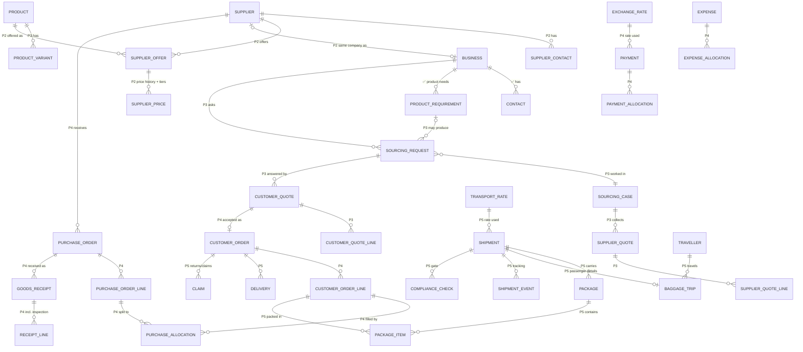

# Sourcing & Import Platform — Audit and Architecture

**Version:** 0.2 · 26 November 2026 (audit refreshed after the customer-module additions; Phase 2 started)
**Scope:** Phase 0 (audit of the existing app) and Phase 1 (target architecture), including the Passenger Baggage component.
**Companion document:** [Customer-Module-Design.md](Customer-Module-Design.md) (the customer module, already built).

Markers used below:
- **[ASSUMPTION]** — something I decided without confirmation. Safe to change later.
- **[VERIFY]** — a legal or factual point that a person must confirm with the proper authority. The software must not decide it.

---

## 1. Phase 0 — Audit of the existing application

### 1.1 Technology in use

| Part | What is used | Keep? |
|---|---|---|
| Frontend + backend | Next.js 16 (App Router, server components, server actions), React 19, TypeScript | Yes |
| Styling | Tailwind CSS 4 with a small set of shared components (`web/src/components/ui.tsx`) | Yes |
| Database | PostgreSQL. Online: Neon (via Vercel). Local: embedded PGlite when `DATABASE_URL` is not set | Yes |
| Data access | Plain SQL through one small layer (`web/src/lib/db.ts`). No ORM | Yes — simple and transparent |
| Migrations | Numbered SQL migrations in `web/src/lib/schema.ts`, applied automatically on start, protected by a database lock | Yes — every new module adds a new migration; old ones are never edited |
| Authentication | One owner account, bcrypt password, server-side sessions (hashed token in the database), setup locked by `SETUP_CODE`, **two-step sign-in** (authenticator app + hashed one-time backup codes) | Extend to multiple users and roles (Phase 6) |
| Settings | `app_setting` key/value table (priority-score money levels) | Yes — use it for future configurable values (transport rates are a separate dated table, see §6.4) |
| Hosting | Vercel (auto-deploys from GitHub `main`) + Neon Postgres (region `iad1`) | Yes |

**Architecture style:** a single application ("modular monolith"). This is the right choice for a small team. Each business area will get its own folder of actions and screens, but they share one database so records can link to each other. No microservices.

### 1.2 Feature map

| Existing feature | Tables | Works well | Needs improvement | Must keep | Extend with |
|---|---|---|---|---|---|
| Customer profile | `business` (+ `customer_kind` business/individual, `merged_into_business_id`), `branch`, `tag`, `business_tag` | Progressive entry, duplicate warning + merge, privacy level, auto stage, business/person switch | — | All data and codes | Link to requests, quotes and orders (Phase 3–4) |
| Contacts | `contact` | Buying / payment authority, contact permission | — | All | Shared later with supplier contacts (same pattern, separate table) |
| How they buy (general) | `purchasing_profile` | Works | Label "purchasing profile" is unclear | All | — |
| Product needs (recurring demand) | `product_requirement`, `requirement_variant`, `value_history` | Source-of-information tracking, history, staleness, score | Word "requirement" is confusing; score table is heavy | All | Link to **requests** (a need can produce many requests) and to **supplier offers** |
| Where they buy now, problems, conditions | `current_source`, `sourcing_problem`, `buying_condition` | Evidence-based, supplier names hidden | — | All | `current_source` can later link to our `supplier` record |
| Conversations | `interaction` (+ links) | Separates "customer said / we saw / we think" | Only works for customers | All | Make it work for **suppliers** too (same table) |
| Follow-ups | `follow_up` | Automatic purchase reminders, forgotten-customer check | Only for customers; no assignee | All | Suppliers, requests and orders; assign to a staff member later |
| Deals | `opportunity`, `opportunity_line`, `opportunity_stage_history` | Verbal ≠ confirmed rule, lost reasons | The word "opportunity" is jargon | All | Will be **replaced in daily use** by Requests → Quotes → Orders (Phase 3–4). Existing deals stay readable |
| Product list | `product_category`, `product` | Shared product identity for adding up demand | No variants, no supplier offers | All | Variants, supplier offers, price history |
| Demand view | (query) | Evidence split, privacy respected | — | — | Request and order quantities |
| Buying groups | `buying_group`, `buying_group_member` | Each customer keeps own quantity and "interested/confirmed"; only confirmed counts; private customers excluded | No price limit or payment status per member yet | All | Phase 4: members link to order lines, so price, payment and allocation are tracked per customer (Part 9) |
| Results report, settings, backup | (queries), `app_setting` | Source → buyer funnel; owner-set score levels; full JSON backup | — | All | Order value and contribution once orders exist |
| CSV export | (route) | Hides supplier names and internal notes | — | — | Supplier export |

### 1.3 Weaknesses found

1. **Customer-only conversations and follow-ups.** `interaction.business_id` and `follow_up.business_id` are required. Suppliers cannot use them. *Fix (planned for Phase 2):* make the customer link optional and add `supplier_id`, with a rule that one of the two must be set.
2. ~~**"Business" assumes every customer is a company.**~~ *Fixed 26 Nov 2026:* `customer_kind` (`business` / `individual`), default `business`.
3. **"Opportunity" mixes sales stages with order stages.** It goes up to "in fulfilment" and "delivered", which belong to orders and shipments. *Fix (Phase 3–4):* new Request → Quote → Order chain. Opportunities become read-only history; new work uses requests.
4. **Single user, no roles.** Fine now. Roles are planned (§8) before staff join.
5. **No money tables yet.** Prices exist only as single numbers on product needs. *Fix (Phase 4):* payments, expenses and exchange-rate records with dates.
6. **No file storage.** Photos and documents are needed for suppliers, inspection and customs. *Fix:* Vercel Blob or Neon-side storage in Phase 3 (needs your approval of the storage service).
7. **Wording.** Many labels used analyst language ("qualified", "provenance", "opportunity", "requirement", "interaction"). *Fixed:* plain-language pass (§9).

### 1.4 Safety of existing data

- Every change is a **new migration** that only adds tables or columns, or relaxes a "required" rule. Nothing is renamed or deleted in the database.
- Stored codes (for example `qualified`) never change. Only the words shown on screen change, so old records keep their meaning.
- Migrations run inside one transaction with a lock. If any step fails, nothing is applied.

---

## 2. Target architecture

### 2.1 Modules and how they connect

```
 Customers ─┬─ Product needs (recurring demand intelligence, built)
            │
            └─ Requests ──► Sourcing case ──► Supplier quotes ──► Comparison
                   │                                 │
                   ▼                                 ▼
             Customer quote ──(accepted)──► Customer order ──► Supplier order (PO)
                                                  │                    │
                                                  │              Goods receipt + inspection (Dubai)
                                                  │                    │
                                                  │              Packages ──► Shipment (route type)
                                                  │                    │         ├─ Courier / air cargo / sea freight
                                                  │                    │         └─ Passenger baggage (trip details)
                                                  │              Compliance check (gate before dispatch)
                                                  │                    │
                                                  └──── Payments, expenses, exchange rates, cost allocation
                                                                       │
                                                         Addis receipt ──► Delivery ──► Returns / claims
                                                                       │
                                                               Reconciliation (estimated vs actual)
 Suppliers ─┬─ Contacts, verification, conversations
            └─ Supplier offers (product + price tiers + price history)
 Tasks / follow-ups and conversations attach to any of the above.
```

### 2.2 Key design decisions

| Decision | Why | Weakness / trade-off |
|---|---|---|
| **Separate `supplier` table** (not one merged "party" table) | The existing `business` table holds customer-only fields (sourcing status, privacy level, stage). Merging would mean a risky migration of live data. A supplier that is also a customer is linked with `supplier.linked_business_id`, so nobody is entered twice. | Two tables for organisations. Acceptable: their commercial data is genuinely different. |
| **"Product need" ≠ "Request" ≠ "Order"** | A *need* is ongoing intelligence ("buys 100 chargers a month"). A *request* is one specific ask ("find me 20 by 10 Dec"). An *order* is a confirmed, paid commitment. Mixing them hides whether demand is real. | Users must understand three words. The screens explain each with one line. |
| **One `shipment` table for every route** | Passenger baggage is a *route type* of shipment, with an extra `baggage_trip` record for flight and allowance details. Packages, tracking events, costs and delivery work the same for every route — nothing is duplicated. | Some shipment fields are unused for some routes. |
| **Allocation tables between orders and purchases** | One purchase can serve several customers (group buying); one customer order can need several suppliers. Allocation rows keep each customer's quantity, price and obligation. | More joins. Necessary for correct costs. |
| **Money is always amount + currency + date** | ETB, AED and USD are all used. Exchange rates change. Every conversion stores the rate used, its date and source. | Slightly more fields to fill; defaults help. |
| **Estimates and actuals kept apart** | Profit cannot be stated while costs are unknown. Each cost line has `kind = estimate / actual`. | — |
| **Compliance is recorded, not decided** | The app records who checked what, with which source, and blocks dispatch until a person signs off. It never says "this is legal" on its own. | Needs a person to review uncertain cases. That is intended. |

### 2.3 Folder structure (code)

```
web/src/lib/actions/<module>.ts     server actions (save, validate, check status rules)
web/src/app/(app)/<module>/...       screens
web/src/lib/schema.ts                migrations (append-only)
web/src/lib/options.ts               dropdown values + on-screen words
```

---

## 3. Entity-relationship diagram (target)

Built tables are marked ✅. Phase numbers show when the rest arrive.



---

## 4. Data dictionary (new entities)

Conventions: every table has `id uuid` primary key, `created_at`, `updated_at`; human codes like `SUP-0001`. Money = `amount double precision` + `currency text` (+ `rate_id` when converted). Status columns are plain text checked by the server against the allowed list and allowed transitions.

### 4.1 Phase 2 — Suppliers (built 26–27 Nov 2026, migration `004_suppliers`)

Also built: `current_source.supplier_id` (a customer's current supplier can point to our supplier record), supplier conversations and follow-ups in the shared `interaction` / `follow_up` tables, and the **supplier comparison** on each customer product page (total for the needed quantity using the right price level, minimum-order fit, local delivery, stock, delivery time, terms, check status — never auto-selected; different currencies are flagged, not added together). Prices store an optional quote number (`source_reference`) so Phase 3 supplier quotes can link to them.

**`supplier`** — one supplier company or seller.

| Field | Type | Required | Notes |
|---|---|---|---|
| `code` | text, unique | auto | `SUP-0001` |
| `display_name` | text | yes | Name used every day |
| `legal_name` | text | no | |
| `supplier_type` | text | yes | `manufacturer`, `authorized_distributor`, `wholesaler`, `retailer`, `trading_company`, `online_seller`, `agent`, `exporter`, `other` |
| `country`, `city`, `address` | text | country yes | Default country `AE` [ASSUMPTION] |
| `website`, `email`, `phone`, `whatsapp` | text | no | Phone stored as typed (international numbers vary) |
| `licence_number`, `tax_number` | text | no | Business identifiers, not personal IDs |
| `categories` | jsonb list of category ids | no | What they sell |
| `brands` | text | no | Free text, comma-separated |
| `currency` | text | yes | Default `AED` — editable, never assumed elsewhere |
| `payment_terms`, `deposit_terms`, `credit_terms` | text | no | |
| `min_order_value` | money | no | |
| `typical_lead_time_days` | number | no | |
| `sample_policy`, `return_policy`, `warranty_terms` | text | no | |
| `export_capable` | yes/no/unknown | no | |
| `delivery_areas` | text | no | |
| `verification_status` | text | yes | `unverified` (default), `pending`, `verified`, `conditional`, `rejected`, `inactive` |
| `verification_*` | booleans + date + by + notes | no | Licence checked, identity checked, address checked, authenticity evidence, bank beneficiary checked. **`verified` cannot be saved unless licence and identity are both checked and a date is given.** |
| `linked_business_id` | → business | no | When the supplier is also a customer |
| `notes` | text | no | |

**`supplier_contact`** — people at the supplier: name, role (`sales`, `ordering`, `finance`, `management`, `other`), phone, WhatsApp, email, preferred channel, `active`.

**`supplier_offer`** — one product as sold by one supplier.

| Field | Type | Notes |
|---|---|---|
| `supplier_id` | → supplier | required |
| `product_id` | → product | optional at first; needed for comparison and matching to customer needs |
| `offer_name` | text | What the supplier calls it |
| `brand`, `model_sku`, `variant`, `specification` | text | Exact item as offered |
| `unit` | text | Same unit list as the rest of the app |
| `origin_country`, `condition` | text | |
| `stock_status` | text | `in_stock`, `low`, `out_of_stock`, `on_order`, `unknown` |
| `moq`, `available_qty` | number | |
| `lead_time_days`, `local_delivery_charge` | number / money | |
| `return_terms`, `warranty` | text | |
| `active` | boolean | |

**`supplier_price`** — the price history and quantity tiers. Prices are **never overwritten**.

| Field | Notes |
|---|---|
| `offer_id` | → supplier_offer |
| `min_qty` | Tier start (1, 5, 10 …). Any number allowed |
| `unit_price`, `currency` | |
| `tax_note` | e.g. "VAT 5% included" — free text, not a rule |
| `valid_from`, `valid_until` | When this price applies |
| `source` | `supplier_quote`, `website`, `call`, `message`, `visit` |
| `recorded_at` | When we wrote it down |

"Current price" = the newest row per tier whose `valid_from` ≤ today and (`valid_until` empty or ≥ today).

**Changed tables:** `interaction` and `follow_up` get an optional `supplier_id`; `business_id` becomes optional; a check requires one of the two.

### 4.2 Phase 3 — Requests, sourcing and quotes (built 27 Nov 2026, migration `005_sourcing_orders`)

**As built:** requests (RQ-) with plain-language use types and a "what's missing" check (description, quantity, use, needed-by date); "unsure" use blocks quoting and ordering. Sourcing cases (SC-) group only open requests for the same product, respecting exclusivity. Supplier quotes (SQ-, up to 3 lines) write `supplier_price` history; choosing one needs a reason, the others become "not chosen", rejected suppliers are blocked. Customer quotes (CQ-) keep a private cost estimate with its own rate snapshot (`cost_rate_to_quote`), a printable customer version without internal figures, revisions (old version marked replaced), and a required reason when rejected. **Not built yet:** file/photo storage (needs a storage service decision).


- **`sourcing_request`**: customer, contact, channel, `use_type` (`personal` / `business_resale` / `business_own_use` / `unsure`), description, link, photo, product (optional), variant, quantity + unit, quality, alternatives accepted, target price + currency, needed-by date, urgency, delivery place, privacy/exclusivity, status (§5.1), assigned user, `product_requirement_id` (optional link to the recurring need).
- **`sourcing_case`**: the investigation. Links to one or more requests **only if compatible** (same product, compatible spec and terms, no exclusivity clash). Holds candidate suppliers, missing information, chosen supplier and the *reason* for the choice.
- **`supplier_quote`** + **`supplier_quote_line`**: what a supplier offered us — reference, date, valid until, lines (offer, qty, unit price, currency), MOQ, delivery charge, tax, payment terms, lead time, return terms. Saving a quote also writes `supplier_price` rows, so price history stays complete.
- **Comparison** is a screen, not a table: for each candidate it shows total cost for the requested quantity (using the right tier + delivery), whether MOQ fits, stock, lead time, verification status, payment and warranty terms. **It never auto-selects**; the user picks and must give a reason.
- **`customer_quote`** + lines: our offer to the customer — product lines, quantity, unit price, service fee, estimated transport, estimated duty/clearance, local delivery, other, total, currency, payment terms, delivery estimate, valid until, exclusions, **uncertain items**. Revisions are new rows with `revision_of` → history kept.

### 4.3 Phase 4 — Orders, buying, money (built 27 Nov 2026, same migration)

**As built:** orders (ORD-) only from a sent/accepted, unexpired quote, with how the customer confirmed (in writing / deposit / full payment — payment required for the last two) and a rate snapshot. Supplier orders (PO-) from the case's chosen quote, with per-customer allocation (never more than bought, never more than a customer ordered; stock purchases need a reason). Receipts (GR-) record arrived / damaged / wrong and the check result; arrived good units are shared out first-allocated-first-filled, and delivery is limited to good units that arrived for that order. Payments (PAY-) in and out, each with its own rate; reversing keeps the record. Costs on one order, or shared across a supplier order by quantity / value / equal / manual split. Order and supplier-order statuses are worked out from what actually happened. Profit shows "not known yet" while a cost is missing and becomes final only when a delivered, fully paid order is closed. Cancelling needs no allocations on supplier orders; any amount kept needs a reason, and the rest shows as a refund owed (also on the Money page).

**Simplified for now:** `payment_allocation` is replaced by a direct order or PO link on each payment; weight-based cost splits wait for Phase 5 package weights; delivery is recorded on the order until shipments exist in Phase 5.


- **`customer_order`** + lines: created only from an accepted quote (in one transaction). Keeps the agreed price and spec as they were — later supplier price changes never alter it.
- **`purchase_order`** + lines: to a supplier; statuses in §5.4. Lines link to the supplier quote line used.
- **`purchase_allocation`**: PO line ↔ customer order line, `qty`, `allocated_cost`, `basis`. Database check + server check: total allocated ≤ quantity received (or ordered, before receipt).
- **`goods_receipt`** + **`receipt_line`**: date, place (e.g. Dubai receiving point), expected vs actual qty, short/extra/damaged/wrong, condition, inspection result, serial/batch/expiry, photos, inspector. A supplier saying "dispatched" does not create a receipt.
- **`payment`**: direction (`in` from customer / `out` to supplier, carrier or traveller), amount, currency, method, reference, date, status (`pending`, `received`/`paid`, `refunded`, `reversed`), received/paid by. **No card numbers, bank passwords or account credentials are stored.**
- **`payment_allocation`**: payment ↔ order or PO, amount.
- **`expense`** + **`expense_allocation`**: category (product, UAE delivery, inspection, handling, packaging, consolidation, international transport, insurance, customs duty, import tax, clearance, Addis handling, local delivery, payment fee, FX fee, refund, other), `kind` (`estimate`/`actual`), amount + currency + rate; allocation method (`quantity`, `weight`, `chargeable_weight`, `value`, `equal`, `manual`) stored with each split.
- **`exchange_rate`**: from, to, rate, date, source, `transaction_specific`. Never updated in place; a new rate is a new row.

### 4.4 Phase 5 — Packages, shipments, compliance, delivery

- **`package`** + **`package_item`** (→ customer order line, qty): type, dimensions, actual weight, volumetric weight, contents photo, packed by/at.
- **`shipment`**: route type (`courier`, `air_cargo`, `sea_freight`, `other_commercial`, `passenger_personal`), carrier/provider, tracking no., origin, destination, dispatch date, ETA, arrival date, actual / volumetric / chargeable weight, freight cost, insurance, status (§5.5), `transport_rate_id` used.
- **`shipment_event`**: milestone, time, place, person, note, photo.
- **`compliance_check`**: see §6.6.
- **`delivery`**: order, qty delivered, method, cost, dates, proof, customer confirmation, problems; partial deliveries allowed.
- **`claim`**: type (wrong item, damage, missing qty, return, refund, replacement), against (supplier / carrier / traveller / us), evidence, money impact, status, resolution history.
- **Passenger baggage tables:** §6.

### 4.5 Phase 6 — Management

- **`app_user`** gets `name`, `role`, `active`. **`audit_log`**: who, when, table, record, change.
- **`task`**: generalises follow-ups (title, assignee, links to any record, due, priority, status, reminder).
- Dashboards (§7) read from the tables above; every number links to its records.

---

## 5. Status definitions and allowed moves

The server refuses any move not listed. Every change is written to a history table.

### 5.1 Request
`new` → `reviewing` → (`needs_details` ⇄ `reviewing`) → `ready` → `finding_suppliers` → `preparing_quote` → `quote_sent` → `waiting_for_customer` → `confirmed` → `completed`. From any open state: `cancelled` or `declined` (with reason).
**Rule:** `ready` requires use type, product detail, quantity and a needed-by date. If use type is `unsure`, the request cannot pass `ready`.

### 5.2 Supplier quote
`requested` → `received` → `chosen` / `not_chosen` / `expired`.

### 5.3 Customer quote
`draft` → `sent` → `accepted` / `rejected` / `expired` / `replaced` (by a revision).

### 5.4 Customer order and supplier order
- Customer order: `confirmed` (deposit or written acceptance) → `buying` → `received_in_dubai` → `shipped` → `in_addis` → `delivered` → `closed`; `cancelled` with refund calculation.
- Supplier order (PO): `draft` → `approved` → `sent` → `accepted_by_supplier` → `deposit_due` → `part_paid` → `paid` → `preparing` → `ready_for_collection` → `part_received` → `received` → `closed`; `cancelled`.

### 5.5 Shipment
`preparing` → `packed` → `dispatched` → `in_transit` → `arrived` → `customs` → `released` → `received_in_addis` → `ready_for_delivery` → `delivered` → `closed`; `held` (exception) from any moving state.
**Gate:** `packed` → `dispatched` is blocked unless the compliance check for this shipment is `cleared_for_route` (§6.6).

### 5.6 Simple status colours (used everywhere)
- **Grey** — not started / draft
- **Blue** — in progress / waiting
- **Amber** — needs attention (missing info, overdue, held)
- **Green** — confirmed / done
- **Red** — problem / cancelled / rejected

---

## 6. Passenger Baggage & Personal-Use Logistics

### 6.1 Purpose
Record and control the current practice of a traveller carrying **genuine personal-use customer orders** from Dubai to Addis Ababa in their baggage, so that every item is traceable, paid for fairly, and only carried when it is lawful to do so.

### 6.2 Three different things — never treated as the same

| Matter | What it means | Who decides | How the app stores it |
|---|---|---|---|
| **1. Airline baggage allowance** | How many kg / pieces the airline lets this passenger check in or carry on, under this ticket, route and fare | The airline (ticket, fare rules) | Weight and piece numbers on the **trip**, with "how we know" (ticket seen / airline confirmed / traveller said) and date |
| **2. Customs personal-use eligibility** | Whether specific goods count as the traveller's or a named person's personal effects that customs allows without commercial import procedures, and within which limits | Ethiopian Customs Commission rules **[VERIFY]** | A **compliance check** per shipment/package: who checked, source, date, result. The app never calculates it |
| **3. Permission to import commercially** | Licences, permits, invoices and declarations needed to import goods for sale | Customs and the relevant ministries **[VERIFY]** | Belongs to the **commercial freight** route only. Commercial goods cannot use the passenger route at all |

A large baggage allowance (1) never makes goods eligible under (2), and (2) never gives permission under (3).

### 6.3 Hard rules enforced by the software
1. **Commercial goods are blocked.** A package that contains any line from an order whose request use type is `business_resale` (or `unsure`) cannot be added to a passenger shipment. There is no override button.
2. **No dispatch without sign-off.** A passenger shipment cannot move to `dispatched` until its compliance check is `cleared_for_route`, with reviewer name, date, source of the rule, and a confirmation that each item is for a named end-user's personal use.
3. **The traveller must know what they carry.** Before handover, the traveller confirms the exact contents list (items, quantities, values). The app records the confirmation time. A traveller can refuse any item.
4. **Weight cannot exceed the allowance.** Committed weight ≤ (ticket allowance + extra baggage bought − weight the traveller keeps for their own belongings).
5. **No splitting.** If items from the same customer order, or the same product for the same customer, appear on two or more passenger shipments within 60 days **[ASSUMPTION: window configurable]**, the app shows a warning and requires a manager's written reason before dispatch. The app has no tool to divide an order across travellers.
6. **Declarations are honest.** Values on the contents list come from the actual purchase records; they cannot be typed lower than the recorded purchase price.
7. **Uncertain → stop.** If any eligibility answer is "don't know", the check stays `needs_review` and dispatch stays blocked.

### 6.4 Tables

**`traveller`** — the passenger. Minimal data only.

| Field | Notes |
|---|---|
| `name`, `phone`, `whatsapp` | Contact |
| `consent_given_at`, `consent_note` | Agreed that we store these details for arranging the trip |
| `relationship` | `staff`, `partner_contact`, `customer`, `other` |
| `notes` | |
| **Not stored** | Passport number, ID numbers, date of birth, home address, ticket PNR/password |

**`baggage_trip`** (1:1 with a `shipment` whose route type is `passenger_personal`)

| Field | Notes |
|---|---|
| `shipment_id` | → shipment (holds packages, events, costs, status — no duplication) |
| `traveller_id` | → traveller |
| `airline`, `flight_number`, `route` | e.g. ET 603, DXB→ADD |
| `departure_at`, `arrival_at` | Local times |
| `checked_allowance_kg`, `checked_pieces`, `max_kg_per_piece` | From the actual ticket |
| `cabin_allowance_kg` | |
| `allowance_basis`, `allowance_verified_at` | `ticket_seen` / `airline_confirmed` / `traveller_said` |
| `extra_baggage_kg`, `extra_baggage_cost` + currency | If bought |
| `reserved_for_traveller_kg` | Their own luggage |
| *calculated* `available_kg` | allowance + extra − reserved |
| *calculated* `committed_kg` | sum of actual package weights on the shipment |
| `airline_restrictions_checked` | yes/no + date + note (batteries, liquids, aerosols, perfumes, etc.) |
| `compensation_rate_id` | → transport_rate used |
| `agreed_compensation` + currency | Calculated, editable with a reason |
| `compensation_status` | `not_due`, `due`, `part_paid`, `paid` (payments go through the shared `payment` table) |

**`transport_rate`** — configurable rates. **Nothing is hardcoded.** The current figure of ETB 1,500 per kg is only entered by you as a rate row.

| Field | Notes |
|---|---|
| `route_type` | `passenger_personal`, `courier`, `air_cargo`, … |
| `name` | e.g. "Traveller rate Dec 2026" |
| `charge_basis` | `per_kg`, `per_piece`, `per_package`, `flat` |
| `amount`, `currency` | |
| `minimum_charge` | optional |
| `rounding` | `exact`, `up_to_0_5_kg`, `up_to_1_kg` |
| `valid_from`, `valid_until` | Old rates kept for history |

**Cost calculation (per shipment):** `chargeable = round(Σ actual package weights, rounding)`; `cost = max(minimum_charge, chargeable × amount)` for per-kg; per-piece/package/flat as named. The result is an **estimate** until the trip is completed, then becomes an **actual** expense, split across the customer orders in the packages by actual weight (default) or another recorded method.

### 6.5 Flow (with handovers)
1. Customer order confirmed; request use type is `personal` for a named end user.
2. Goods received and inspected in Dubai → **package** created with contents and actual weight.
3. Trip created (shipment with route `passenger_personal` + baggage trip details).
4. Packages assigned → weight checked against allowance.
5. **Compliance check** completed and signed off (§6.6).
6. Traveller confirms contents → event `handed_to_traveller` (who, when, photo).
7. Events: `departed`, `arrived`, `customs_passed` or `held`, `handed_to_addis_receiver`.
8. Addis receipt → customer **delivery** → customer confirms.
9. Traveller compensation paid (payment record) → actual cost allocated → order profit updated.
10. Problems at any point → **claim / incident** (missing, damaged, held, confiscated), with evidence and money impact.

### 6.6 Compliance check (shared by all routes)

| Field | Notes |
|---|---|
| `shipment_id` / `package_id` | What is being checked |
| `route_type` | Planned route |
| `use_confirmed` | Each item has a named end user and personal-use declaration (passenger route) — or commercial documents listed (freight routes) |
| `quantity_reasonable` | Person's judgement, with note |
| `restricted_items_checked` | Airline and customs restricted/prohibited lists checked; list of items flagged |
| `eligibility_source` | e.g. "Ethiopian Customs Commission guidance, page/link, date read" **[VERIFY]** |
| `documents` | Invoices, packing list, airway bill, permits (freight); contents list signed by traveller (passenger) |
| `status` | `not_checked`, `needs_review`, `documents_requested`, `waiting_external`, `cleared_for_route`, `not_eligible_for_route`, `customs_cleared`, `held` |
| `reviewed_by`, `reviewed_at`, `notes` | Required for `cleared_for_route` |

---

## 7. Dashboards (Phase 6)

Each number opens the list of records behind it.

- **Customers:** total, active, by type and area, needing follow-up, repeat buyers.
- **Demand:** most requested products, interest vs confirmed quantities, upcoming purchases, possible group buys, shortfalls against supplier MOQ.
- **Suppliers:** total, verified, by category, average lead time, quote response rate, price changes, delivery problems.
- **Buying:** open sourcing cases, quotes waiting, orders to place, goods waiting for receipt/inspection.
- **Shipping:** preparing, in transit, held at customs, in Addis, deliveries due, late; traveller trips and free baggage space.
- **Money:** revenue, actual cost, estimated vs actual, owed by customers, owed to suppliers and travellers, contribution by order/product/customer, expenses by category, money held per currency.

**Limit:** this app tracks operations and order-level profit. It does **not** replace accounting software or tax filing.

---

## 8. Security and permissions plan

| Role | Can do |
|---|---|
| Admin | Everything, including users and rates |
| Manager | Everything except users; approves compliance sign-offs and split-warning overrides |
| Sales | Customers, needs, requests, customer quotes; cannot see supplier prices or margins |
| Buying (procurement) | Suppliers, supplier quotes, POs, receipts |
| Logistics | Packages, shipments, trips, deliveries |
| Finance | Payments, expenses, rates, reconciliation |
| Read-only | View only, no exports |

Plus: audit log of important changes, two-step login for all users, private file storage with short-lived links, no secrets in logs, duplicate-submission protection (disable buttons while saving + database unique keys), daily database backups and a monthly export.

---

## 9. Plain-language and simpler screens (done in this round)

### 9.1 What was confusing (review)
1. Analyst words: "requirement", "qualified", "provenance/basis", "opportunity", "interaction", "acquisition source", "commitment level".
2. The customer page had **7 tabs and 9 summary cards**, plus many coloured chips in the header.
3. The product page showed a large score table before the facts.
4. Two names for the same thing (for example "Quick capture" vs "Add", "Pipeline" vs "Opportunities").
5. Error messages written for developers ("Missing: …; …").

### 9.2 Word list (used everywhere)

| Old word | New word | Short explanation shown on screen |
|---|---|---|
| Quick capture | **Add customer** | |
| Requirement | **Product need** | A product this customer buys or wants regularly |
| Interaction | **Conversation** | A visit, call or message |
| Opportunity / Pipeline | **Deal / Deals** | A possible sale we are working on |
| Commitment level | **How firm is it?** | Verbal yes is not an order |
| Qualified | **Ready to quote** | We know enough to make an offer |
| Specified | **Details known** | |
| Well served | **Happy with current supplier** | |
| Basis / provenance | **Where did this come from?** | Customer told us · We saw it · From a document · Our estimate · Our guess · Customer doesn't know · Customer won't say |
| Willingness to test | **Will they try us?** | |
| Sourcing status | **Happy with current suppliers?** | |
| Buying conditions | **Their conditions** | What we must meet to win the sale |
| Current sources | **Where they buy now** | |
| Purchasing profile | **How they buy** | |
| Acquisition source | **How we found them** | |
| Confidentiality level | **Privacy** | |
| Opportunity score | **Priority score** | Higher = better use of your time |
| Evidence completeness | **Backed by facts** | |
| Catalog product | **Product list item** | |

### 9.3 Layout changes
- Customer page: **5 tabs** (Summary, Products, Problems & suppliers, People & places, Conversations & deals) and **5 summary cards**.
- Header shows one status and one action row.
- Product need page: facts first; the score breakdown is behind "Why this score?".
- One main button per screen, in the same place.

---

## 10. Phased delivery

| Phase | Content | Status |
|---|---|---|
| 0 | Audit | ✅ this document |
| 1 | Architecture, data design, baggage design | ✅ this document |
| 2 | Suppliers: profile, contacts, verification, offers, price tiers + history, conversations, follow-ups, link to customer needs and comparison on the product page | ✅ Built and tested 27 Nov 2026 |
| 3 | Requests, sourcing cases, supplier quotes (with lines), customer quotes with revisions; file storage | ✅ Built and tested 27 Nov 2026 (file storage not yet) |
| 4 | Orders, purchase orders, allocation, receipts + inspection, payments, expenses, exchange rates | ✅ Built and tested 27 Nov 2026 |
| 5 | Packages, shipments, **passenger baggage trips**, transport rates, compliance checks, delivery, claims | Next |
| 6 | Users and roles, audit log, tasks, dashboards, reconciliation reports | |

## 11. Test scenarios (acceptance)

Scenarios A–H from the brief are the acceptance tests for Phases 3–5. Additional baggage tests:
- **B1** Commercial order (retailer, 50 units, resale) → adding its package to a passenger trip is refused.
- **B2** Personal order with compliance `needs_review` → dispatch refused.
- **B3** Packages totalling 26 kg on a trip with 23 kg available → refused with the numbers shown.
- **B4** Rate changed from one value to another → earlier trips keep the old rate and cost.
- **B5** Same customer's items on two trips within the window → warning + manager reason required.
- **B6** Traveller has not confirmed contents → handover refused.

## 12. Assumptions and open points
- [ASSUMPTION] Default supplier country UAE and currency AED, both editable.
- [ASSUMPTION] Split-detection window 60 days, configurable.
- [VERIFY] Ethiopian customs personal-use limits and documentation — to be read from official Ethiopian Customs Commission sources and recorded in each compliance check.
- [VERIFY] Airline restricted items (lithium batteries, aerosols, perfumes, liquids) — from the airline's current rules for each trip.
- Open: which file storage to use (Vercel Blob is the simplest with the current hosting).
